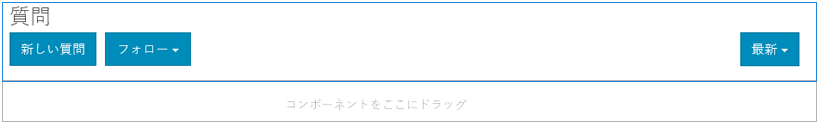
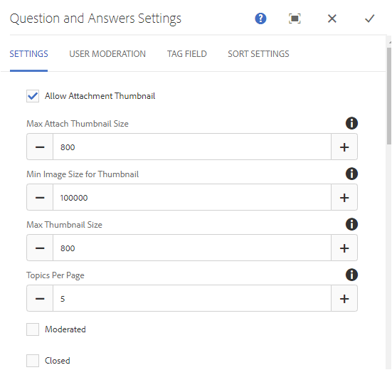

# Q&amp;A フォーラム機能{#q-a-forum-feature}

## はじめに {#introduction}

QnA （質問と回答）フォーラム機能は、コミュニティメンバーが質問と回答を行うためのエリアを提供します。 メンバーは次のことが可能になります。

* 質問の作成
* インライン画像の追加（ドラッグ&amp;ドロップをサポート）
* 質問の表示と回答
* 質問を検索
* QnA コンテンツの調整を支援する
* 最適な回答を特定
* QnAの質問をページ間で移動

このドキュメントには、次の内容が記載されています。

* AEM サイトへのQnA フォーラム機能の追加。
* `QnA` コンポーネントの構成設定。

## ページへのQ&amp;A フォーラムの追加 {#adding-a-q-a-forum-to-a-page}

作成者モードでページに`QnA` コンポーネントを追加するには、コンポーネントブラウザーを使用して`Communities / QnA`を見つけ、QnA フォーラムが表示されるページ上に配置するようにコンポーネントをドラッグします。

必要な情報については、[&#x200B; コミュニティコンポーネントの基本](/help/communities/basics.md)を参照してください。

[必要なクライアントサイドライブラリ &#x200B;](/help/communities/qna-essentials.md#essentials-for-client-side)が含まれている場合、`QnA` コンポーネントは次のように表示されます。

### QnAの設定 {#configuring-qna}

配置された`QnA` コンポーネントを選択して、編集ダイアログを開く`Configure` アイコンにアクセスして選択できるようにします。

#### 「設定」タブ {#settings-tab}

「**設定**」タブで、トピック（質問）と返信（回答）の設定を指定します。

* **添付ファイルのサムネールを許可**

  オンにすると、添付された画像のサムネールが作成されます。

* **最大添付サムネールサイズ**

  添付ファイルのサムネール画像の最大サイズ（ピクセル単位）。 デフォルト値は800 x 800です。

* サムネール **の**&#x200B;最小イメージ サイズ

  インライン画像のサムネールを生成するための画像の最小サイズ（バイト単位）。 デフォルト値は100000 バイト（100 kb）です。

* **サムネールの最大サイズ**

  インライン画像のサムネール画像の最大サイズ（ピクセル単位）。 デフォルト値は800 x 800です。

* **ページあたりのトピック**

  ページごとに表示される質問/投稿の数を定義します。 初期設定は 10 です。

* **モデレート**

  オンにすると、トピックとコメントの投稿は、公開サイトに表示される前に承認する必要があります。 デフォルトの選択は解除されます。

* **終了**

  オンにすると、フォーラムは新しい質問やコメントに対してクローズされます。 デフォルトの選択は解除されます。

* **リッチテキストエディター**

  オンにすると、マークアップを使用してトピックとコメントを入力できます。 デフォルトの選択は解除されます。

* **タグ付けを許可**

  オンにした場合、メンバーが投稿にタグラベルを追加できるようにします（**タグフィールド** タブを参照）。 デフォルトの選択は解除されます。

* **ファイルのアップロードを許可**

  チェックを入れた場合は、質問またはコメントに添付ファイルを追加できます。 デフォルトの選択は解除されます。

* **次を許可**

  チェックを入れた場合は、フォーラムへの投稿に次の機能を含めます。これにより、メンバーは新しい投稿について[通知](/help/communities/notifications.md)を受け取ることができます。 デフォルトの選択は解除されます。

* **ピン留めを許可**

  オンにすると、フォーラムのトピックをトピックのリストの先頭にピン留めできます。 デフォルトの選択は解除されます。

* **メール配信の許可**

  チェックを入れた場合は、新しい投稿がメールでメンバーに通知されるようにします（[&#x200B; サブスクリプション &#x200B;](/help/communities/subscriptions.md)）。 「次の項目を許可」をオンにして[電子メールを設定](/help/communities/email.md)する必要があります。 デフォルトの選択は解除されます。

* **最大ファイルサイズ**

  `Allow File Uploads`がチェックされている場合にのみ関連します。 このフィールドは、アップロードされたファイルのサイズ（バイト単位）を制限します。 デフォルトは104857600 （10 Mb）です。

* **許可されているファイル形式**

  `Allow File Uploads`がチェックされている場合にのみ関連します。 「ドット」区切り文字を持つファイル拡張子のコンマ区切りリスト。 例：.jpg、.jpeg、.png、.doc、.docx、.pdf。 任意のファイルタイプを指定した場合、指定しなかったファイルタイプはアップロードできません。 デフォルトは、**すべて**&#x200B;のファイルタイプが許可されるように指定されていません。

* **最大アタッチ画像ファイル サイズ**

  「ファイルのアップロードを許可」がオンになっている場合にのみ関連します。 アップロードされた画像ファイルの最大バイト数。 デフォルトは2097152 （2 Mb）です。

* **返信を許可**

  オンにした場合、質問に投稿されたコメントへの返信を許可します。 デフォルトの選択は解除されます。

* **投票を許可**

  チェックを入れた場合は、質問に投票機能を含めます。 デフォルトの選択は解除されます。

* **ユーザーによるコメントとトピックの削除を許可**

  オンにした場合、メンバーは投稿したコメントや質問を削除できます。 デフォルトの選択は解除されます。

* **特権メンバーを許可**

  オンにした場合、コンテンツの作成が許可されるのは特権メンバーのみです。

* **作成者編集モードでユーザーが生成したコンテンツをブロック**

  有効にすると、作成者モードでの編集中にユーザー生成コンテンツがブロックされます。

* **選択した回答を上位に移動**

  オンにした場合、最初に表示される回答は選択済みの回答です。 デフォルトの選択は解除されます。
* **バッジの表示**

  チェックを入れた場合、メンバーのブログエントリで獲得および割り当てられた[&#x200B; バッジ &#x200B;](/help/communities/implementing-scoring.md)を表示します。 デフォルトの選択は解除されます。

* **おすすめのコンテンツを許可**

  チェックを入れると、アイデアは[おすすめコンテンツ &#x200B;](/help/communities/featured.md)として識別できます。 デフォルトの選択は解除されます。

* **メンションを有効にする**

  有効にすると、登録コミュニティユーザーは他の登録メンバー（名、姓、ユーザー名を使用）を識別し、共通の@user-name構文を使用してタグ付けすることができます。 タグ付けされたユーザーは、メンションに関する通知を受け取ります。

* **最大言及数**

  投稿で許可されるメンションの最大数を制限します。 初期設定は 10 です。

* **UI メンション パターン**

  投稿に登録されたユーザーをタグ（@mention）付けする許可されたパターン文字列を指定します。 例えば、`~{{familyName}}{{givenName}}` のように指定します。

#### 「User Moderation」タブ {#user-moderation-tab}

「**ユーザーモデレーション**」タブで、投稿されたトピック（質問）と回答（ユーザー生成コンテンツ）の管理方法を指定します。 詳しくは、「[&#x200B; ユーザー生成コンテンツの管理](/help/communities/moderate-ugc.md)」を参照してください。

* **回答を拒否**

  チェックを入れると、信頼できるメンバーのモデレーターは、投稿された回答を拒否し、回答が公開されたQ&amp;A フォーラムに表示されないようにすることができます。 デフォルトの選択は解除されます。

* **トピックを閉じる/再度開く**

  オンにすると、信頼できるメンバーのモデレーターは、質問（トピック）を閉じてさらに編集と回答を行い、質問を再度開くことができます。 デフォルトの選択は解除されます。

* **トピックの移動**
オンにした場合、パブリッシュサイドのモデレーターが質問を移動できるようにします。 デフォルトの選択は解除されます。

* **投稿にフラグを付ける**

  チェックを入れた場合、他のメンバーの質問や回答に不適切なフラグを付けることができます。 デフォルトの選択は解除されます。

* **フラグ理由リスト**

  チェックを入れた場合、質問または回答に不適切なフラグを付ける理由をドロップダウンリストからメンバーが選択できるようにします。 デフォルトの選択は解除されます。

* **カスタムフラグの理由**

  チェックを入れた場合、メンバーが質問や回答に不適切なフラグを付けた独自の理由を入力できるようにします。 デフォルトの選択は解除されます。

* **モデレーションしきい値**

  モデレーターに通知する前に、メンバーが質問または回答にフラグを立てる回数を入力します。 デフォルトは1 （1回）です。

* **フラグ設定の上限**

  質問または回答が公開ビューから非表示になる前にフラグを立てる必要がある回数を入力します。 -1に設定すると、フラグ付きの質問または回答が公開ビューから非表示になることはありません。 それ以外の場合、この数値はモデレーションしきい値以上である必要があります。 デフォルトは 5 です。

#### 「タグフィールド」タブ {#tag-field-tab}

「**タグ」フィールド** タブでは、**設定** タブで許可されている場合、適用できるタグは、選択した名前空間に応じて制限されます。

* **許可された名前空間**

  `Allow Tagging`が「**設定**」タブでチェックされている場合に関連します。 適用できるタグは、オンにした名前空間カテゴリ内のタグに制限されます。 名前空間のリストには、「標準タグ」（デフォルトの名前空間）と「すべてのタグを含める」が含まれます。 デフォルトは「なし」にチェックされます。つまり、すべての名前空間が許可されます。

* **推奨回数**

  フォーラムに投稿するメンバーに提案として表示するタグの数を入力します。 **-**&#x200B;1の値は制限がないことを意味します。 初期設定は 0 です。

#### 「並べ替え設定」タブ {#sort-settings-tab}

「**並べ替え設定**」タブで、投稿されたコメントの表示時の並べ替え方法を指定します。

* **並べ替え基準**

  許可されているすべての並べ替え選択を確認してください：`Newest, Oldest, Last Updated, Most Viewed, Most Active, Most Followed and Most Liked`。 デフォルトは `Newest, Oldest, Last Updated` です。

* **既定として設定**

  チェックした並べ替えオプションの1つを選択して、デフォルトとして表示します。 デフォルトは `Newest` です。

* **Analyticsの並べ替えの時間オプションを選択**

  `All, Last 24 Hours, Last 7 Days, Last 30 Days`のいずれかを選択するには、ドロップダウンします。 デフォルトは `All` です。

## サイト訪問者エクスペリエンス {#site-visitor-experience}

### 回答の特定 {#identifying-answers}

1つの回答は、`Select Answer` ボタンを使用して、正解または有効な回答としてマークできます。 質問に「回答済み」とマークすると、最初の回答が`Unmark Chosen Answer` ボタンを使用して選択解除されるまで、別の回答を選択できません。

有効な回答として選択したら、`Unmark Chosen Answer` ボタンを使用して選択を解除できます。

回答が実行可能な回答として選択されると、質問が`Answered`されたことを示す表示が、メインのQnA ページの質問トピックの横に表示されます。

#### モデレーターと管理者 {#moderators-and-administrators}

ログインしたユーザーにモデレーターまたは管理者権限がある場合、質問または回答の作成者に関係なく、コンポーネントの設定で許可されているモデレーションタスクを実行できます。

また、回答を特定することもできます。

#### メンバー {#members}

サイト訪問者がログインすると、設定に応じて、次のことが可能になります。

* 新しい質問を投稿します。
* 自分が作成した質問を編集または削除できます。
* 他のメンバーの質問や回答にフラグを付けることができます。
* 自分が作成した質問に対する回答を特定します。

#### 匿名 {#anonymous}

ログインしていないサイト訪問者は、投稿された質問と回答を読んだり、サポートされている場合にのみ翻訳したりすることができますが、質問を追加したり、回答を表示したり、他のユーザーの投稿にフラグを立てたりすることはできません。

## 追加情報 {#additional-information}

詳細については、開発者向けの[QnA Essentials](/help/communities/qna-essentials.md) ページを参照してください。

投稿されたトピックとコメントの管理については、[&#x200B; ユーザー生成コンテンツの管理](/help/communities/moderate-ugc.md)を参照してください。

投稿されたトピックとコメントのタグ付けについては、[&#x200B; ユーザー生成コンテンツのタグ付け](/help/communities/tag-ugc.md)を参照してください。
