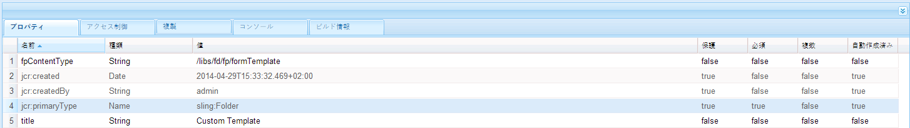
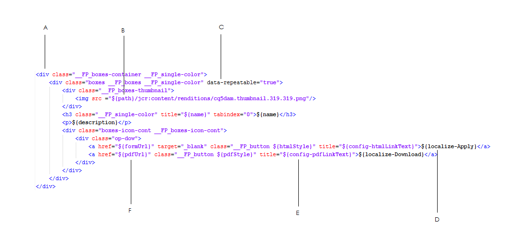

# フォームポータルコンポーネントのテンプレートのカスタマイズ{#customizing-templates-for-forms-portal-components}

## 前提条件 {#prerequisites}

[フォームメタデータの管理](../../forms/using/manage-form-metadata.md)

HTML および CSS の実用的な知識

## 概要 {#overview}

AEM Forms ユーザーインターフェイスでは、すべてのフォームにメタデータを追加することができます。 カスタムメタデータにより、組織のフォームをリストおよび検索する際のユーザーエクスペリエンスを向上させることができます。

フォームポータルを使用すると、フォームリストにカスタムメタデータを使用することができます。 アセットのカスタムテンプレートの作成中に、レイアウトを変更して、カスタムメタデータを CSS スタイルセットと使用することができます。

次の手順を実行して、様々なフォームポータルコンポーネントのカスタムテンプレートを作成することができます。

## カスタムテンプレートの作成 {#creating-a-nbsp-custom-template}

1. /appsの下にsling:Folder ノードを作成します

   &quot;fpContentType&quot; プロパティを追加 カスタムテンプレートを設定しようとしているコンポーネントに応じてプロパティの適切な値を指定します。

   * Search &amp; Lister コンポーネント：&quot;/libs/fd/fp/formTemplate&quot;
   * ドラフト／送信コンポーネント：

     * ドラフトセクション：/libs/fd/fp/draftsTemplate
     * 送信セクション：/libs/fd/fp/submissionsTemplate

   * Link コンポーネント：&quot;/libs/fd/fp/linkTemplate&quot;

   レイアウトテンプレートを選択する際に表示したいタイトルを追加します。

   >[!NOTE]
   >
   >タイトルは、作成したsling:Folderのノード名とは異なる場合があります。

   次の画像は、Search &amp; Listerコンポーネントの構成を示します。
   

1. このフォルダー内に template.html ファイルを作成して、カスタムテンプレートとして使用することができます。
1. 以下のようにカスタムテンプレートを作成して、カスタムメタデータを使用します。

## 作業の例 {#working-example}

以下は、フォームポータルが、Search &amp; Lister コンポーネントのカスタム Geometrixx Gov カードのレイアウトを取得したカスタムテンプレートの実装例です。

```html
<div class="__FP_boxes-container __FP_single-color">
    <div class="boxes __FP_boxes __FP_single-color" data-repeatable="true">
 <div class="__FP_boxes-thumbnail">
     
        </div>
        <h3 class="__FP_single-color" title="${name}" tabindex="0">${name}</h3>
        <p>${description}</p>
        <div class="boxes-icon-cont __FP_boxes-icon-cont">
            <div class="op-dow">
                <a href="${formUrl}" target="_blank" class="__FP_button ${htmlStyle}" title="${config-htmlLinkText}">${localize-Apply}</a>
                <a href="${pdfUrl}" class="__FP_button ${pdfStyle}" title="${config-pdfLinkText}">${localize-Download}</a>
            </div>
        </div>
    </div>
</div>
```

## カスタムテンプレートの技術仕様 {#technical-specifications-for-custom-templates}

すべてのフォームポータルコンポーネントのカスタムテンプレートには、繰り返し可能なエントリと繰り返し不可能なエントリが含まれています。 繰り返し可能なエントリは、リスト表示の基本エンティティです。 Search &amp; Lister、ドラフト&amp;提出および Link コンポーネントなどが繰り返し可能なエントリの例です。

フォームポータルは、プレースホルダーに構文を提供してカスタム／標準メタデータを表示します。 プレースホルダーは、フォーム、ドラフトまたは提出の結果を表示した後に追加されます。

繰り返し可能なエントリを含めるには、**data-repeatable** の属性の値を **true** に設定します。

*説明した例では、2 つの Div 要素はカスタムテンプレートの一番上に存在します。 最初に、&quot;__FP_boxes-container&quot; CSSクラスで、リストされているフォームのコンテナの要素として機能します。 2 番目に、&quot;__FP_boxes&quot; CSSクラスで基本エンティティのテンプレート、この場合、フォームになります。 Div 要素に存在する&#x200B;**data-repeatable**&#x200B;の属性の値は&#x200B;**true**&#x200B;です。*

それぞれのプレースホルダーには 1 つずつ標準メタデータセットがあります。 フォームの特定の場所にカスタムメタデータを表示するには、その場所に&#x200B;**${metadata_prop} プロパティ**&#x200B;を追加します。

*この例では、メタデータプロパティは複数のインスタンスで使用されています。 例えば、**description**、**name**、**formUrl**、**htmlStyle**、**pdfUrl**、**pdfStyle**、および&#x200B;**path**&#x200B;で所定の方法で使用されます。*

## すぐに使えるメタデータ {#out-of-the-box-metadata}

様々なフォームポータルコンポーネントは、リスト表示に使用できる排他的な標準メタデータのセットを提供します。

### Search &amp; Lister コンポーネント {#search-amp-lister-component}

* **タイトル：**&#x200B;フォームのタイトル
* **name**：フォーム名（多くの場合、タイトルと同じです）
* **description**：フォームの説明
* **formUrl**：フォームを HTML としてレンダリングする URL
* **pdfUrl**：フォームを PDF としてレンダリングする URL
* **アセットタイプ**：アセットの種類 有効な値には、**フォーム**、**PDF フォーム**、**印刷フォーム**&#x200B;および&#x200B;**アダプティブフォーム**&#x200B;などがあります。

* **htmlStyle**&amp; **pdfStyle**：HTML の表示スタイルと PDF アイコンはそれぞれレンダリングに使用されています。 有効な値は、「**__FP_display_none**」または空白です。

>[!NOTE]
>
>カスタムスタイルシートでは必ず __FP_display_none クラスを使用してください。

* **downloadUrl**：アセットをダウンロードする URL です。

ローカリゼーション、ソート、ユーザーインターフェイス上での設定プロパティ使用のサポート（Search &amp; Lister のみ）:

1. **ローカリゼーションサポート**：静的テキストをローカライズするには、属性 `${localize-YOUR_TEXT}` を使用し、ローカライズされた値が存在しない場合は、値を用意します。
   *上記の例では、属性 `${localize-Apply}` と `${localize-Download}` は、「Apply」と「Download」のテキストをローカライズするのに使用します。*

1. **並べ替えのサポート**：HTML 要素をクリックして、検索結果を並べ替えます。 テーブルレイアウトでの並べ替えを実行するには、特定のテーブルヘッダーに「data-sortKey」属性を追加します。 さらに、ソートしたいメタデータとしてその値を加えます。
例えば、グリッド表示の「タイトル」ヘッダーでは、「data-sortKey」ヘッダーの値が「タイトル」 です。 見出しをクリックすると、特定の列の値を並べ替えることができます。

1. **設定プロパティの使用**：Search &amp; Listerコンポーネントには、ユーザーインターフェイスに使える設定がいくつかあります。 例えば、編集ダイアログを通して保存された HTML ツールヒントテキストを表示するには、`${config-htmlLinkText}` 属性を使用します。 **同様に、PDF ツールヒントテキストにも、** `${config-pdfLinkText}` 属性を使用します。

### リンクコンポーネント {#link-component}

* **タイトル：**&#x200B;フォームのタイトル
* **formUrl**：フォームを HTML としてレンダリングする URL
* **ターゲット**：リンクのターゲット属性 有効な値は、「_blank」および「_self」です。
* **linkText**：リンクキャプション

### ドラフトと送信コンポーネント {#drafts-amp-submissions-component}

* **Path**：ドラフト／送信メタデータノードのパス ドラフトまたは送信を開くには、URL として HTML 拡張子と一緒に使用してください。
* **contextPath**：AEM インスタンスのコンテキストパス
* **firstLetter**：ドラフトとして保存または送信されたアダプティブフォームのタイトルの最初の文字（大文字）。
* **formName**：ドラフトとして保存または送信されたアダプティブフォームのタイトル。
* **draftID**：リストされているドラフトの ID（「ドラフト」セクションのテンプレートでのみ使用します）。
* **submitID**：リストされている送信の ID（「送信」セクションのテンプレートでのみ使用します）。
* **status**：送信されたフォームのステータス （「送信」セクションのテンプレートでのみ使用します）。
* **description**：ドラフトまたは送信に関連付けられたアダプティブフォームの説明。
* **diffTime**：ドラフトの場合は、現在の時刻と最後の保存アクションとの差。 送信の場合は、現在の時刻と最後の送信されたアクションとの差。
* **iconClass**：ドラフト／送信の最初の文字を表示するために使用する CSS クラス。 フォームポータルには、様々な色の背景を提供する以下のクラスがあります。
* **owner**：ドラフト／送信を作成したユーザー。
* **Today**：`DD:MM:YYYY` 形式のドラフト作成日または送信日。
* **TimeNow**：`HH:MM:SS` 24 時間形式のドラフト作成時間または送信時間。

*注意：*

1. ドラフト&amp;送信コンポーネントの下のドラフトセクションにある削除のオプションについては、CSS クラスを &quot;__FP_deleteDraft&quot; と名付けます。 さらに、属性「draftID」に、対応するドラフトのドラフト IDである値&#x200B;**${draftID}**&#x200B;を含めます。

1. ドラフトと送信を開くためのリンクを作成する際に、アンカータグの&#x200B;**href**&#x200B;属性の値として&#x200B;**${path}.html**&#x200B;を指定できます。



**A**。コンテナ要素

**B.** フォームごとに保存されたサムネールを取得するための固定階層を持つ「パス」メタデータ。

**C.** 各フォームのテンプレートセクションに使用する Data-repeatable 属性

**D.** 「Apply」文字列をローカライズする

**E.** pdfLink テキストの設定プロパティを使用する

**F.** 「pdfUrl」メタデータを使用する

## ヒント、テクニック、既知の問題 {#tips-tricks-and-known-issues}

1. カスタムテンプレートでは一重引用符（‘）を使用しないでください。
1. カスタムメタデータの場合は、このプロパティを&#x200B;**jcr:content/metadata** ノードにのみ保存します。 他の場所に保存した場合、フォームポータルはメタデータを表示できません。
1. すべてのカスタムメタデータまたは既存のメタデータの名前にコロン（:）が含まれていないことを確認してください。 含まれている場合、ユーザーインターフェイスに表示することができません。
1. **data-repeatable** は、**リンク**&#x200B;コンポーネントにとっては意味はありません。 アドビシステムズ社は、お客様がこのプロパティのリンクコンポーネントのテンプレートにおける使用を避けることを推奨します。

## 関連記事

* [フォームポータルコンポーネントの有効化](/help/forms/using/enabling-forms-portal-components.md)
* [フォームポータルページの作成](/help/forms/using/creating-form-portal-page.md)
* [API を使用した Web ページ上のフォームの一覧表示](/help/forms/using/listing-forms-webpage-using-apis.md)
* [ドラフトと送信コンポーネントの使用](/help/forms/using/draft-submission-component.md)
* [ドラフトと送信済みフォームのストレージのカスタマイズ](/help/forms/using/draft-submission-component.md)
* [ドラフトと送信コンポーネントをデータベースと統合するサンプル](/help/forms/using/integrate-draft-submission-database.md)
* [フォームポータルコンポーネントのテンプレートのカスタマイズ](/help/forms/using/customizing-templates-forms-portal-components.md)
* [ポータル上のフォーム公開の概要](/help/forms/using/introduction-publishing-forms.md)
