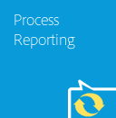
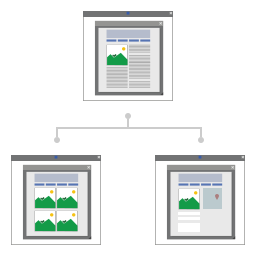
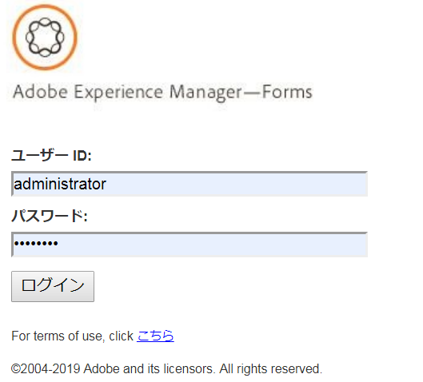

# プロセスレポートの概要{#introduction-to-process-reporting}

プロセスレポートは、AEM Forms のプロセスとタスクに関するレポートを作成および表示するために使用する、ブラウザーベースのツールです。

プロセスレポートは、標準の一連のレポートを提供し、長時間実行中のプロセス、プロセス期間、ワークフローの量に関する情報のフィルタリングと表示を行います。

さらに、プロセスレポートには、アドホッククエリを実行し、カスタムレポートビューをプロセスレポートユーザーインターフェイスに統合するためのインターフェイスが用意されています。

サポートされているブラウザーの一覧については、 [AEM Forms サポートプラットフォーム](/help/forms/using/aem-forms-jee-supported-platforms.md)を参照してください。

プロセスレポートは、以下のモジュールにもとづいて構築されています。

* AEM Forms Database からプロセスデータを読み取る
* 埋め込みプロセスレポートリポジトリーにプロセスデータを公開
* レポートを表示するためのブラウザーベースのユーザーインターフェイスを提供

## 主な機能 {#key-capabilities}

### 常時稼動のレポート {#always-on-reporting}

長時間実行されているプロセスのリスト、期間グラフの処理、およびフィルターを使用したカスタムクエリの実行を表示します。

また、プロセスレポートでは、レポートおよびクエリデータを CSV 形式で書き出すオプションも提供されます。

### アドホックレポート {#adhoc-reports}

フィルターを使用して、データの特定の表示を取得します。

ID、期間、開始日と終了日、プロセスイニシエーターなどで、プロセスまたはタスクを検索できます。

複数のフィルターを組み合わせて、特定のレポートを作成できます。

その後、後で実行するようにレポートフィルターを保存できます。

### プロセス／タスクの履歴 {#process-task-history}

AEM Forms サーバーは、多数のプロセスを並行して実行します。 これらのプロセスは、ある状態から別の状態への移行を続けます。 Forms のデータを一定の間隔でプロセスレポートリポジトリーに公開すると、プロセスレポートには、AEM Forms で実行中のプロセスに関する移行情報が保持されます。

### アクセス制御 {#access-control-br}

プロセスレポートは、ユーザーインターフェイスへの権限ベースのアクセスを提供します。

つまり、レポート権限を持つユーザーのみがプロセスレポートのユーザーインターフェイスにアクセスできます。
