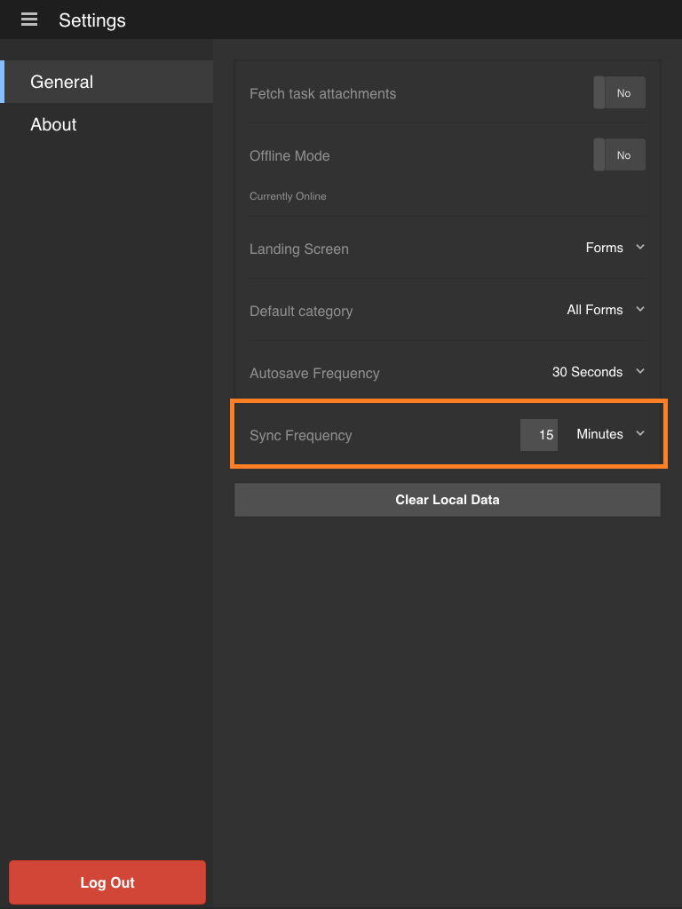

# アプリケーションの同期{#synchronizing-the-app}

>[!NOTE]
>
>AEM Forms アプリは現在、非推奨です。 質問またはヘルプについては、[aemformsapp-android@adobe.com](mailto:aemformsapp-android@adobe.com)までお問い合わせください。

## アプリケーションの同期 {#synchronizing-the-app-1}

アプリケーション内のフォームが AEM Forms サーバーからダウンロードされます。 フォームは、「タスク」タブと「フォーム」タブにダウンロードされます。 フォームから作成されたドラフトは「ドラフト」タブにダウンロードされ、タスクから作成されたドラフトは「タスク」タブにダウンロードされます。 OSGi サーバー上のスタンドアロンフォームの場合、フォームとドラフトは、「フォーム」タブと「ドラフト」タブにそれぞれダウンロードされます。

アプリケーションがオンラインの場合、フォームを完了し送信すると、そのフォームはすぐに AEM Forms サーバーにアップロードされます。 アプリケーションが同期されると、そのフォームはサーバーから取得されます。 ただし、アプリケーションがオンラインの場合、ドラフトはただちにサーバーと同期されます。

AEM Forms サーバーにオンラインで接続している場合、デフォルトでは、15 分ごとにアプリケーションが同期されます。 ただし、この同期頻度を変更するオプションがあります。 あるいは、任意の時点でアプリケーションを手動で同期することもできます。

**アプリケーションを手動で同期するには**

ホーム画面の右下隅にある「同期」ボタン  を選択してください。

**同期頻度を変更するには**

1. 設定画面に移動するには、ホーム画面の左上隅にあるメニューボタンを選択してから、「**設定**」を選択します。
1. 設定画面で、「一般」タブを選択します。

   

1. 「同期の頻度」オプションで、「同期の頻度」の右側の値を選択します。
1. ドロップダウンリストで、新しい同期頻度を選択します。

### 技術仕様 {#technical-specifications}

* AEM Forms サーバーへのオフラインアプリケーションデータの送信のメインロジックは runtime/offline/util/offline.js に含まれます。
* .jsで、processOfflineSubmittedSavedTasks （。..）への呼び出し 関数は、保存/送信されたタスクをサーバーに送信します。 同期処理でのエラーや競合も処理されます。 タスクの送信に失敗すると、アプリケーションのタスクは失敗としてマークされます。 さらに、タスクは Outbox に残ります。
* syncSubmittedTask() および syncSavedTask() 関数は、個別のタスクに操作を実行します。
* ユーザーがサーバーへのオフライン状態の同期またはバックグラウンドスレッドによる自動同期を選択した後、タスクリストコンポーネントによって、processOfflineSubmittedSavedTasks() 関数への呼び出しが開始されます。
