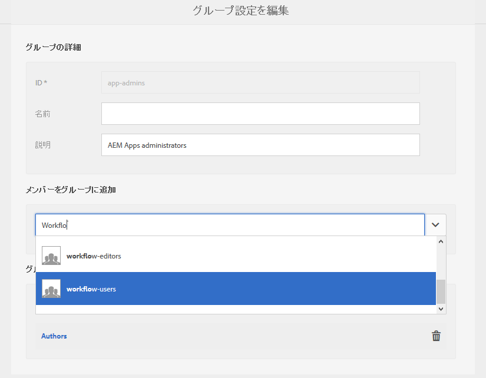

# ユーザーとユーザーグループの設定 {#configure-your-users-and-user-groups}

{{ue-over-mobile}}

この章では、ユーザーの役割と、モバイルアプリのオーサリングと管理をサポートするようにユーザーとグループを設定する方法について説明します。

## AEM Mobile Application Users and Group Administration {#aem-mobile-application-users-and-group-administration}

### AEM Mobile Application Content Authors （アプリ作成者グループ） {#aem-mobile-application-content-authors-app-author-group}

アプリ作成者グループのメンバーは、ページ、テキスト、画像、動画などのAEM モバイルアプリケーションコンテンツのオーサリングを担当します。

#### グループ設定 – app-authors {#group-configuration-app-authors}

1. 「app-authors」というユーザーグループを作成します。

   ユーザーAdmin Consoleに移動します：[http://localhost:4502/libs/granite/security/content/groupadmin.html](http://localhost:4502/libs/granite/security/content/groupadmin.html)

   ユーザーグループコンソール内から「+」ボタンを選択してグループを作成します。

   このグループのIDを「app-authors」に設定して、AEM内のモバイルアプリケーションのオーサリングに固有のオーサーユーザーグループの特定のタイプであることを示します。

1. グループにメンバーを追加：作成者

   

1. アプリ作成者ユーザーグループを作成したので、[&#x200B; ユーザーAdmin Console](http://localhost:4502/libs/granite/security/content/useradmin.md)を使用して、この新しいグループに個々のチームメンバーを追加できます。

   

1. 次の機能を使用すると、AEMのコンテンツ作成者グループに追加できます。

   （読み取り） on

   * /app
   * /etc/clientlibs
   * /etc/designs
   * /etc/cloudservices/dps2015

### AEM Mobile Application Administrators Group （app-admins group） {#aem-mobile-application-administrators-group-app-admins-group}

app-admins グループのメンバーは、app-authors **AND**&#x200B;に含まれているのと同じ権限でアプリケーションコンテンツをオーサリングできます。また、次の責任も負います。

* アプリケーション ContentSync OTA アップデートのステージング、公開、クリア

>[!NOTE]
>
>権限は、AEM App Command Centerで一部のユーザーアクションが使用可能かどうかを判断します。
>
>アプリ管理者が利用できるアプリ作成者には、一部のオプションが使用できないことに注意してください。

### グループ設定 – app-admins {#group-configuration-app-admins}

1. app-adminsという名前のグループを作成します。
1. 新しいapp-admins グループに次のグループを追加します。

   * content-authors
   * ワークフローユーザー

   

   >[!NOTE]
   >
   >workflow-usersは、PhoneGap Build サービスを使用してリモートビルドする必要があります

1. [権限コンソール &#x200B;](http://localhost:4502/useradmin)に移動し、cloudservicesを管理する権限を追加します

   * （読み取り、変更、作成、削除、複製） /etc/cloudservices/mobileservices

1. 同じ権限コンソールで、アプリのコンテンツ更新をステージング、公開、クリアする権限を追加します。

   * （読み取り、変更、作成、削除、複製） /etc/packages/mobileapp
   * （読み取り） /var/contentsync

   >[!NOTE]
   >
   >パッケージレプリケーションは、オーサーインスタンスからパブリッシュインスタンスにアプリのアップデートを公開するために使用されます

   >[!CAUTION]
   >
   >/var/contentsync アクセスは標準で拒否されます。
   >
   >READ権限を省略すると、空の更新パッケージがビルドおよびレプリケートされる可能性があります。

1. 必要に応じてこのグループにメンバーを追加します
1. コンテンツを書き出したりアップロードしたりするには

   * （読み取り） /etc/contentsyncで書き出しテンプレートにアクセス
   * （Read） on /var to path traversal on read
   * （読み取り、書き込み、変更、削除）を/var/contentsyncで書き込み、読み取り、クリーンアップ ContentSync キャッシュ書き出しコンテンツ

### その他のリソース {#additional-resources}

AEM Mobile On-demand Services アプリの作成に関するその他の2つの役割と責任について詳しくは、次のリソースを参照してください。

* [AEM Mobile On-demand Services向けAEM コンテンツの開発](/help/mobile/aem-mobile-on-demand.md)
* [AEM Mobile On-demand Services アプリ用AEM コンテンツのオーサリング](/help/mobile/mobile-apps-ondemand.md)
