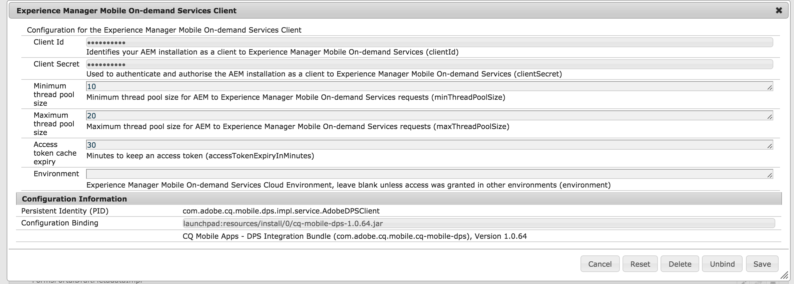

# AEM Mobile のセットアップ{#aem-mobile-setup}

{{ue-over-mobile}}

>[!CAUTION]
>
>既存のAdobe Experience Manager（AEM）モバイルアプリのお客様がAEM 6.2または6.3からAEM 6.5に移行する場合、引き続きPackage ShareからパッケージをダウンロードしてAEM Mobile Appsを使用できます。 ただし、AEM 6.5の新しいインストールでは、AEM Mobile アプリ機能はサポートされていません。

AEMを使用してAEM Mobile アプリケーション用のコンテンツを作成するには、AEM インスタンスをクラウドベースのAEM Mobile On-demand Services アカウントおよびプロジェクトと統合する必要があります。

AEM Mobileを設定し、AEM内でコンテンツを作成および管理できるようにするには、次の手順に従います。

## AEM Mobile Provisioning {#aem-mobile-provisioning}

AEM Mobileの設定を開始するには、次の手順を実行する必要があります。

* **API キーを要求**: On-Demand Services APIにアクセスするには、API キーを要求する必要があります。 API キーをリクエストするには、[PDF フォーム &#x200B;](https://helpx.adobe.com/digital-publishing-solution/help/aem-mobile-end-of-life-faq.html)に記入してください。 記入したフォームをAdobe Developer サポートに送信します：[wwds@adobe.com](mailto:wwds@adobe.com)

* **デバイス IDとデバイス トークンを生成**: API キーを受け取ったら、デバイス IDとデバイス トークンを生成できます。 `https://aex.aemmobile.adobe.com`に移動し、次の操作を行います。

  * API キーを指定
  * 次の権限を持つAEM Mobile プロジェクトに追加したAdobe IDでログインします（プロジェクトを作成するには、以下の手順を参照）。

    * 管理/ プロジェクトとユーザーの管理
    * コンテンツ/コンテンツの追加と編集、コンテンツの削除、コンテンツの表示、コンテンツの公開

すべての条件が満たされると、デバイス IDとデバイストークンが生成されます。

>[!NOTE]
>
>必要なAdobe IDには、AEM Mobile プロジェクトへのアクセス権を付与する必要があります。 オンラインヘルプの「[AEM Mobileのアカウント管理](https://helpx.adobe.com/digital-publishing-solution/help/aem-mobile-end-of-life-faq.html)」を参照してください。

## AEM Mobileのプロジェクトの作成 {#creating-projects-for-aem-mobile}

プロジェクトを作成する際は、対象となるプラットフォーム（iOS、Android™、Windows、デスクトップ Web ビューア）の設定を指定します。 指定するプロジェクト設定の多くは、アプリの動作に影響します。

プロジェクトを作成するには、マスター管理者ロールを持つAdobe IDを使用してOn-Demand Services ポータルにログインする必要があります。 プロジェクトを編集するには、マスター管理者ロールまたは&#x200B;**プロジェクトとユーザーの管理**&#x200B;権限を持つユーザーロールが必要です。

>[!NOTE]
>
>AEM Mobileでのプロジェクトの作成について詳しくは、[こちら](https://helpx.adobe.com/digital-publishing-solution/help/creating-projects.html)をクリックしてください。

## AEM Mobile コネクタの設定 {#configuring-an-aem-mobile-connector}

AEMの設定には、コネクタの設定に関する次の手順が含まれます。 AEM Mobile コネクタの設定が完了すると、ユーザーはユーザーグループと権限を設定できます。

AEM Mobile On-Demand コネクタは、AEM Mobile管理コンテンツをAdobe Experience Manager Mobileのオンデマンドサービスとバインドするために使用されます。 これにより、コンテンツ作成者は、AEMのツールを使用してモバイルアプリケーションのコンテンツを制作、管理しながら、AEM Mobileのオンデマンドサービスを使用してモバイルコンテンツを簡単に配信できます。

>[!NOTE]
>
>これは、AEM インスタンスを設定するための1回限りの手順です。

### AEM Mobile On-demand Services クライアントの設定 {#configuring-aem-mobile-on-demand-services-client}

AEM Mobile統合が正しく機能するように設定する手順を完了します。

1. OSGI サービス設定に移動

   1. AEM/ツール/オペレーション/Web コンソール
   1. ***Experience Manager Mobile On-demand Services Client （旧Adobe Digital Publishing Solution Client）***&#x200B;をスクロールまたは検索します

1. ***Experience Manager Mobile On-demand Services Client***&#x200B;を編集

   1. **（必須）**&#x200B;必須フィールドを入力します：

      1. クライアント ID。
      1. クライアントシークレット。

   1. **（オプション）**&#x200B;既存の値を編集します。

1. 変更を保存します。
1. 次に、設定の例を示します。

### AEM Mobile On-demand Services CloudServiceの設定 {#configuring-aem-mobile-on-demand-services-cloudservice}

1. Cloud Servicesに移動します。

   1. AEM/ツール/デプロイメント > [CloudServices](http://localhost:4502/libs/cq/core/content/tools/cloudservices.html)。 スクロールするか、***Adobe Experience Manager Mobile オンデマンドサービス***&#x200B;を検索します

1. ***今すぐ設定***&#x200B;または&#x200B;***設定を表示***&#x200B;を選択し、設定を追加アイコンを選択します。

1. 設定の作成

   1. タイトルと名前を入力する
   1. デバイス IDを入力
   1. デバイストークンを入力
   1. 入力された値を検証するには、***デバイス設定をテスト***&#x200B;を選択します
   1. 「OK」を選択

## AEM Mobile ユーザーロールの追加と権限の割り当て {#adding-aem-mobile-user-roles-and-assigning-permissions}

プロジェクトを作成したら、役割を作成し、ユーザーにアクセス権を付与する必要があります。 ロールを作成および編集できるのはマスター管理者のみです。 役割を作成する場合、その権限が割り当てられているユーザーの機能（または権限）を有効にします。 例えば、アプリ構築の権限を含む役割と、コンテンツの作成と公開の権限を含む役割を作成できます。

AEM Mobile アプリ開発には、次の3つの異なる役割があります。

* 管理者
* 開発者
* 作成者

アプリの作成やコンテンツの作成と公開など、様々な権限を持つロールの作成について詳しくは、AEM Mobile ヘルプの「[&#x200B; ユーザーのロールの作成とアクセス権の付与](https://helpx.adobe.com/digital-publishing-solution/help/account-admin-dps.html)」をクリックしてください。

>[!NOTE]
>
>アプリのコンテンツを管理するには、開発者、コンテンツ作成者、管理者などの協力が必要です。 作成者はページを操作します。ページは、アプリ開発者によって生成されたテンプレートとコンポーネントにもとづいています。 最後に、管理者は更新されたアプリコンテンツを戦略的に公開します。 AEMのグループと権限を設定すると、アプリダッシュボードまたはコントロールセンターで役割が定義されます。
>
>[AEM Mobile ダッシュボード &#x200B;](/help/mobile/mobile-apps-ondemand-application-dashboard.md)を参照してください。

アプリの作成やコンテンツの作成と公開など、異なる権限を持つ役割を作成する場合は、[**ユーザーグループとユーザーグループの設定**](/help/mobile/aem-mobile-configure-users.md)&#x200B;を参照してください。 これにより、モバイルアプリのオーサリングと管理をサポートするようにユーザーとグループを設定できます。

### その他のリソース {#additional-resources}

AEM Mobile On-demand Services アプリの作成に関するその他の2つの役割と責任について詳しくは、次のリソースを参照してください。

* [AEM Mobile On-demand Services向けAEM コンテンツの開発](/help/mobile/aem-mobile-on-demand.md)
* [AEM Mobile On-demand Services アプリ用AEM コンテンツのオーサリング](/help/mobile/mobile-apps-ondemand.md)

>[!NOTE]
>
>閲覧ページや記事を含むアプリのコンテンツをプレビューするには、[&#x200B; プリフライトを使用したプレビュー](/help/mobile/aem-mobile-manage-ondemand-services.md)を参照してください。
