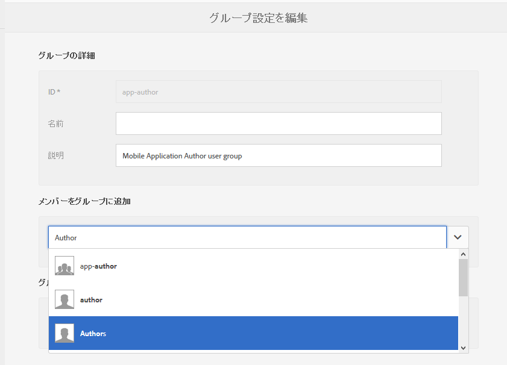
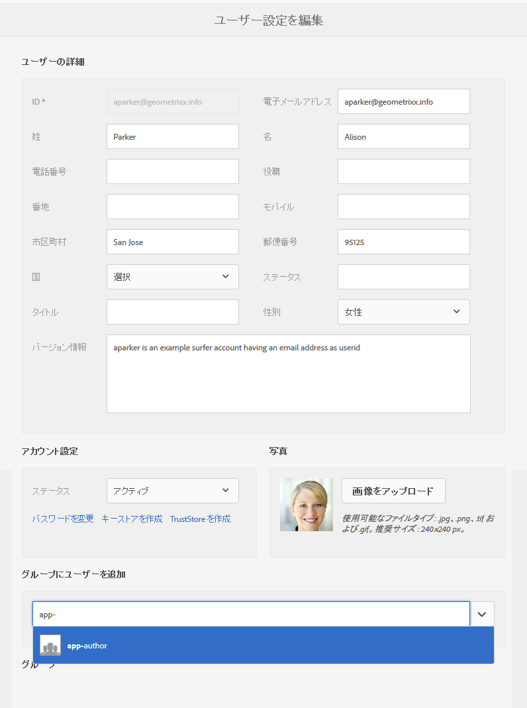
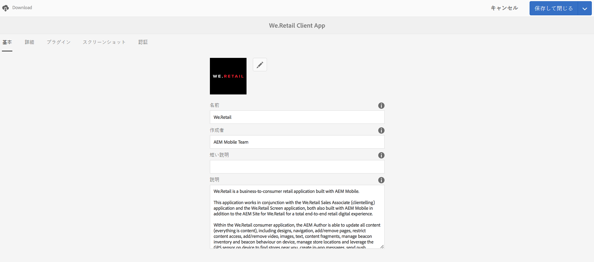

# ユーザーとユーザーグループの設定 {#configure-your-users-and-user-groups}

{{ue-over-mobile}}

この章では、ユーザーの役割と、モバイルアプリのオーサリングと管理をサポートするようにユーザーとグループを設定する方法について説明します。

## AEM Mobile Application Users and Group Administration {#aem-mobile-application-users-and-group-administration}

AEM アプリの権限モデルの整理と管理を支援するために、次の2つのグループを使用できます。

* app-admins for App Admins
* app-authors for App Authors

### AEM Mobile Application Content Authors （アプリ作成者グループ） {#aem-mobile-application-content-authors-app-author-group}

アプリ作成者グループのメンバーは、ページ、テキスト、画像、動画などのAEM モバイルアプリケーションコンテンツのオーサリングを担当します。

#### グループ設定 – app-authors {#group-configuration-app-authors}

1. 「app-authors」というユーザーグループを作成します。

   ユーザーAdmin Consoleに移動します：[http://localhost:4502/libs/granite/security/content/groupadmin.html](http://localhost:4502/libs/granite/security/content/groupadmin.html)

   ユーザーグループコンソール内から「+」ボタンを選択してグループを作成します。

   このグループのIDを「app-authors」に設定して、AEM内のモバイルアプリケーションのオーサリングに固有のオーサーユーザーグループの特定のタイプであることを示します。

1. グループにメンバーを追加：作成者

   

   作成者グループにアプリ作成者を追加

1. アプリ作成者ユーザーグループを作成したので、[&#x200B; ユーザーAdmin Console](http://localhost:4502/libs/granite/security/content/useradmin.md)を使用して、この新しいグループに個々のチームメンバーを追加できます。

   

   ユーザーグループの編集

1. [権限コンソール &#x200B;](http://localhost:4502/useradmin)に移動し、cloudservicesを管理する権限を追加します

   * （読み取り） /etc/cloudservices

   >[!NOTE]
   >
   >App Authorsは、デフォルトのcontent-authors （Authors）グループをAEMから拡張し、/content/phonegapの下にコンテンツを作成する機能を継承します

### AEM Mobile Application Administrators Group （app-admins group） {#aem-mobile-application-administrators-group-app-admins-group}

app-admins グループのメンバーは、app-authors **AND**&#x200B;に含まれているのと同じ権限でアプリケーションコンテンツをオーサリングできます。また、次の責任も負います。

* AEMでのPhoneGap BuildとAdobe Mobile Services Cloud Servicesの設定
* アプリケーションのステージング、公開、クリア Content Sync OTA アップデート

>[!NOTE]
>
>権限は、AEM App Command Centerで一部のユーザーアクションが使用可能かどうかを判断します。
>
>アプリ管理者が利用できるアプリ作成者には、一部のオプションが使用できないことに注意してください。

#### グループ設定 – app-admins {#group-configuration-app-admins}

1. app-adminsという名前のグループを作成します。
1. 新しいapp-admins グループに次のグループを追加します。

   * content-authors
   * ワークフローユーザー

   

1. [権限コンソール &#x200B;](http://localhost:4502/useradmin)に移動し、cloudservicesを管理する権限を追加します

   * （読み取り、変更、作成、削除、複製） /etc/cloudservices/mobileservices
   * （読み取り、変更、作成、削除、複製） /etc/cloudservices/phonegap-build

1. 同じ権限コンソールで、アプリのコンテンツ更新をステージング、公開、クリアする権限を追加します

   * （読み取り、変更、作成、削除、複製） /etc/packages/mobileapp
   * （読み取り） /var/contentsync

   >[!NOTE]
   >
   >パッケージレプリケーションは、オーサーインスタンスからパブリッシュインスタンスにアプリのアップデートを公開するために使用されます

   >[!CAUTION]
   >
   >/var/contentsync アクセスは標準で拒否されます。
   >
   >READ権限を省略すると、空の更新パッケージがビルドおよびレプリケートされる可能性があります。

1. 必要に応じてこのグループにメンバーを追加します

## ダッシュボードタイルの権限 {#dashboard-tile-permissions}

ダッシュボードタイルでは、ユーザーが持つ権限に基づいて、様々なアクションを表示できます。 次に、各タイルで使用できるアクションを示します。

これらの権限に加えて、現在のアプリの設定方法に基づいてアクションを表示/非表示にすることもできます。 例えば、PhoneGap クラウド設定がアプリに割り当てられていない場合、「リモートビルド」アクションを公開する点はありません。 これらは、&#39;**構成条件**&#39; セクションの下にリストされています。

### アプリを管理タイル {#manage-app-tile}

現在、タイルには権限を必要とするアクションはありませんが、アプリケーションの詳細ページには次のアクションがあります。

* *App-authorおよびapp-admin用に*&#x200B;を編集（UI トリガー - jcr:write - /content/phonegap/{suffix}）
* *App-authorおよびapp-admin向けのダウンロード* （/content/phonegap/{suffix}のUI トリガー）

次の画像は、アプリの「ダウンロード」オプションと「編集」オプションを示しています。

