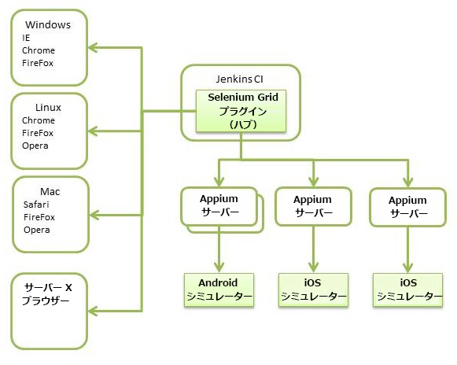

# モバイルアプリのテスト{#testing-mobile-apps}

{{ue-over-mobile}}

市場に出回っている幅広いデバイスとリリースされているデバイスを考えると、アプリのテストは不可欠なものとなっています。 これは、機能と使いやすさがアプリストアで低いレビューを集める可能性がありますが、1つの欠陥が原因でアプリがアンインストールされる可能性があります。 試験計画と品質保証には、慎重に注意する必要があります。 次のリンクでは、環境の特定、テストケースの定義、テストの種類、仮定、顧客の関与など、一般的に対処する必要がある多くのトピックについて説明します。 また、テストの取り組みに役立つツールについても説明します。 [Hobbes](/help/sites-developing/hobbes.md)などの内部ツールは、web ベースのUI テストに役立ちます。 [&#x200B; タフな日](/help/sites-developing/tough-day.md)は、シミュレートされた負荷でインスタンスに負荷をかけることができます。 テスト環境でSeleniumなどのサードパーティツールの使用経験がある場合は、これも使用できます。

モバイルアプリを開発する際には、従来のテストと合わせて対処しなければならないデバイスに特有の新しい懸念事項が数多くあります。

* 機能的 – すべての要件がアプリで満たされていますか？
* ユーザビリティ – アプリは使いやすく、お客様に理解してもらえますか？
* パフォーマンス – 使用率が急増した場合はどうなりますか？ スワイプやカルーセルなどのアプリ要素は、素早く、エクスペリエンスを損なうことはありませんか？
* 失敗または中断 – アプリの実行中に着信呼び出しまたは通知が発生した場合はどうなりますか？ ネットワークの停止または電源オフが発生した場合はどうなりますか？
* インストールとアップデート – インストールのエクスペリエンスはどうですか？ 更新はどのようにプッシュされますか？
* テクニカル – アプリがデバイスから電力を消費しすぎていますか？
* ローカライズ – アプリ内のすべての領域が翻訳されていますか？
* 認定 – あなたのアプリは認定を受けていますか？ 顧客は、データプライバシーの法的要件をすべて満たしていると信頼できますか？

これらの質問は、自動テストと手動テストで回答する必要があります。

## テストの自動化 {#automated-testing}

画面サイズ、メモリの制約、入力方法、オペレーティングシステムなど、さまざまなデバイスに対応するために、ある程度の自動テストを実行する必要があります。 多くのテストケースをカバーしているだけでなく、新しい機能やデバイスが導入されたときに、回帰テストを迅速化することができます。 自動化ツールは、作業の重複を減らすか、制限することが理想的です。 ツールやフレームワークを利用して、テスト作業があらゆるプラットフォームに対応できるようにします。 次のグラフは、web ベースのUI テストとモバイルアプリテストの両方のテスト環境の簡略化された構造を示しています。 グラフの左側には、ブラウザーを持つ一連のSelenium ノードが表示されます。 SeleniumGridは、web ベースの一般的なUI テストをこれらのノードのいずれかにファームアウトできます。 Selenium ハブは、クロスプラットフォームのアプリテストのためにAppiumに接続することもできます。 シミュレータのみが表示されますが、adb、Android™およびXcodeの各ユーティリティをiOS デバイスに組み込むことができます。 このドキュメントの後半でリンクが提供され、前述のツールの具体的な詳細を確認できます。

## 手動テスト {#manual-testing}

自動テストに加えて、アプリは手動テストのサイクルを経る必要があります。 実際のデバイスでアプリを実行しているお客様は、スクリプトによって複製することはできません。 ここでも、多くのオプションがあります。 HockeyAppなどのプラットフォームを使用して、アクセスできるユーザーを定義し、フィードバックを収集できます。 また、UTest、ElusiveStars、Testinなどのサービスに、プロセス全体をアウトソーシングすることもできます。 内部テスターのグループが存在するが、デバイスのバリエーションが不足している場合は、クラウドサービスを使用して、それらのデバイスプールで手動テストを実行できます。 これを提供するサービスの1つがSauceLabsです。 また、PhoneGap Enterpriseにリモートでアプリを構築し、受け入れテストやデモのレベルとしてローカルデバイスにインストールすることもできます。 最新の機能とドキュメントについては、PhoneGap （`https://phonegap.com/`）のweb サイトを参照してください。 どのようなアプローチであれ、手作業によるテストでは次のことをおこなう必要があります。

* テスターを大量に獲得し，
* デバイスの大きなプールに対してテストします（理想的には実際のデバイスですが、実際のデバイスが利用できない場合はシミュレータ/エミュレータ）。
* 有益なフィードバックの提供：

  * クラッシュレポート，
  * 分析/トラッキング，
  * ユーザビリティ，
  * 注目すべき領域，
  * パフォーマンス，
  * データや電力の消費などを行います。

## ツール {#tools}

モバイルアプリのテストに使用できるツールは多岐にわたります。 機能、価格、サポート、カバー範囲など、特定の状況に応じて選択する必要があります。 次に、利用可能なツールとサービスの一部を簡単に説明します。

**Selenium**

* WebDriverをフィードし、さまざまなブラウザーを制御するためのテストスクリプト用APIを含むフレームワーク。
* Appiumで実際のデバイスでテストする場合に使用できます。
* SeleniumGridは、並列テスト用にノード間でテストを指示します。
* Selenium IDEは、テストケースの書き込みを減らすのに役立ちます。

詳しくは、[https://www.selenium.dev/](https://www.selenium.dev/) を参照してください。

**Testdroid**

* 継続的な統合フックとリアルデバイステストを備えたクラウドベースのテストサービス。
* デバイスの互換性をチェックし、ログを分析し、ビューをトラバースし、スクリーンショットを撮り、パフォーマンスをモニターするアプリWeb クローラーが含まれています。

詳しくは、[https://testdroid.com/](https://testdroid.com/)を参照してください。

**Appium**

* Appiumは、モバイルテストを自動化するための人気のあるクロスプラットフォームフレームワークです。
* また、インスペクターには、コードテストケースを支援する記録機能が含まれています。

詳しくは、[https://appium.io/](https://appium.io/)を参照してください。

**SauceLabs**

* SauceLabsは、クラウドベースのテストを提供し、継続的な統合と統合しています。
* テストは、クラウド環境で自動的に実行されるか、特定のデバイスやプラットフォームを開始して手動テストを実行し、問題のデバッグに役立てることができます。

詳しくは、[https://saucelabs.com/](https://saucelabs.com/)を参照してください。

<!--
**AppTestNow**

* An outsourcing service that tests your mobile apps.
* Included is a large pool of devices and offers a wide range of types of testing: performance, quality, functional, certification, localization, data consumption, and so on.

For more information, see [https://apptestnow.com/](https://apptestnow.com/).
-->

**HockeyApp**

* HockeyAppは手作業によるテストに該当し、モバイルアプリは個人用アプリストアにプッシュされ、テスターがダウンロードして試すことができます。

詳しくは、[https://hockeyapp.net/features/](https://hockeyapp.net/features/)を参照してください。

**ジェンキンス**

* テストツールではありませんが、Jenkinsは自動テスト用のバックボーンを提供する継続的な統合フレームワークです。 機能を拡張するために、数多くの3rd パーティのプラグインを利用できます。 例えば、SeleniumGrid プラグインは、Selenium ハブとノードの管理に役立つUIを提供します。

詳しくは、[https://www.jenkins.io/](https://www.jenkins.io/)および[https://plugins.jenkins.io/](https://plugins.jenkins.io/)を参照してください。
