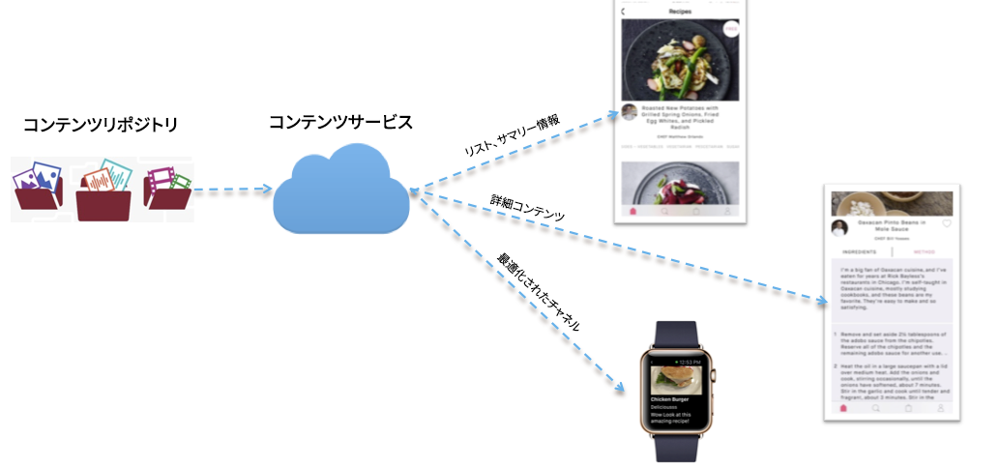

# コンテンツサービス{#content-services}

{{ue-over-mobile}}

>[!CAUTION]
>
>コンテンツサービス機能は、プレビューのみを目的として文書化されています。
>
>6.3 サービスパック 1のリリースに伴い、変更される可能性があります。

AEM Mobile Content Servicesは、AEMで管理されるコンテンツをリクエストするための軽量な機能です。 これにより、すべてのアプリ開発者は、AEMのコンテンツリポジトリ（JCR）とweb フレームワーク（Sling）に関する深い知識がなくても、パフォーマンスの高いコンテンツ取得方法を利用できます。 これにより、リクエスト側のアプリケーションをコンテンツリポジトリから切り離すことができます。

Content Servicesには、開発者がAEMで管理されているコンテンツにアクセスできる新しいAEM コンストラクトがいくつか導入されています。このコンストラクトを使用すると、そのコンテンツのリポジトリ構造を知る必要はありません。

これらの構成は、AEMで管理されるコンテンツと、コンテンツを利用するモバイルアプリとの間に抽象化レイヤーを提供することで、柔軟性を維持し、将来の拡張を可能にするために必要です。 これにより、AEM Content Servicesは、ネイティブアプリケーションのコンテンツ要件とAEM コンテンツリポジトリの間の抽象化レイヤーとして機能します。

コンテンツサービスは、アセット、パッケージ化されたHTML（HTML/CSS/JS）、またはチャネルに依存しないコンテンツとしてコンテンツを配信できます。

>[!CAUTION]
>
>**前提条件：**
>
>コンテンツサービスを開始する前に、コンテンツサービスフラグを有効にしていることを確認してください。 アプリでモデルの作成と管理を有効にするには、設定ブラウザーでデータモデルを有効にします。
>
>詳しくは、**[コンテンツサービスの管理](/help/mobile/developing-content-services.md)**&#x200B;および[設定ブラウザー](/help/sites-administering/configurations.md)のドキュメントを参照してください。

Content Services フラグを設定し、Configuration Browserでデータモデルを有効にした後、AEM Mobile Content Servicesの使用を開始するには、以下のリソースを参照してください。 AEM Mobile Content Servicesのモデル管理、エンティティ管理、コンテンツ配信/レンダリングなど、コンテンツサービスの概念を理解します。

* リポジトリ内のモデル
* レンダリングと配信
