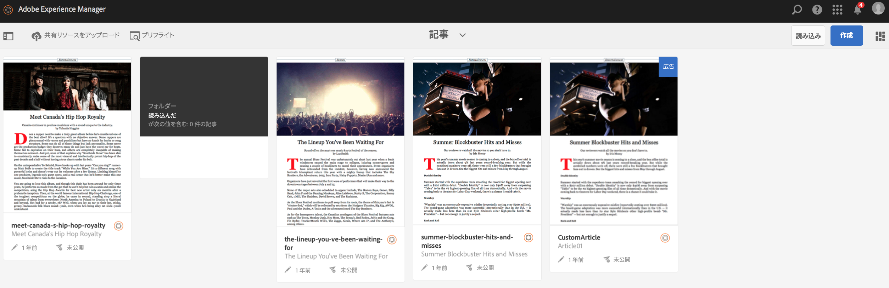

# 共有リソースのアップロード {#uploading-shared-resources}

{{ue-over-mobile}}

コンテンツ管理アクションは、アプリケーション内でコンテンツを作成および管理するのに役立つ構成要素です。 アプリケーション内のコンテンツに対して、次のアクションが実行されます。

>[!NOTE]
>
>AEM Mobile アプリのデザインに関する考慮事項について詳しくは、オンラインヘルプの「[AEM Mobile アプリのデザインに関する考慮事項](https://helpx.adobe.com/digital-publishing-solution/help/design-app.html)」を参照してください。

>[!CAUTION]
>
>まずモバイルオンデマンド接続を関連付けます。

## 共有リソースのアップロード {#uploading-shared-resources-1}

通常、記事などのコンテンツは、あらゆる制作者やアプリをまたいで同じ外観を保つ必要があります。 したがって、すべての人がスクリプト、CSS、フォントを利用できるようにすることが不可欠です。 この操作により、このような共有リソースがMobile On-Demandに送信され、必要に応じて使用できます。

アプリを設定してクラウド設定に関連付けたら、共有リソースをアップロードできます。 アプリをクラウド設定に関連付ける詳細な手順については、[こちら](/help/mobile/mobile-apps-ondemand-application-create-configure-action.md)をクリックしてください。

>[!NOTE]
>
>Shared Resourcesでは、ContentSyncを使用して、様々なリソースをすべて収集します。 詳しくは、[ContentSyncを使用したモバイル ](/help/mobile/mobile-ondemand-contentsync.md)を参照してください。

記事の共有リソースをアップロードするには、次の手順に従います。

1. **記事を管理** タイルから記事を選択します。
1. 「**共有リソースのアップロード**」をクリックして、共有HTML リソースをアップロードします。

   

### 次の手順 {#the-next-step}

コンテンツの作成と公開について学習したら、「

* [AEM Mobile On-demand Services向けAEM コンテンツの開発](/help/mobile/aem-mobile-on-demand.md)
* [AEM Mobile On-demand Servicesを使用するためのコンテンツの管理](/help/mobile/aem-mobile.md)

オーサリングトピックについて学ぶ必要がある場合は、を参照してください。

[AEM Mobile On-demand Services アプリ用AEM コンテンツのオーサリング](/help/mobile/mobile-apps-ondemand.md)
