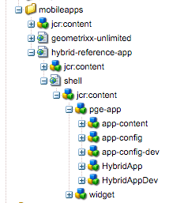
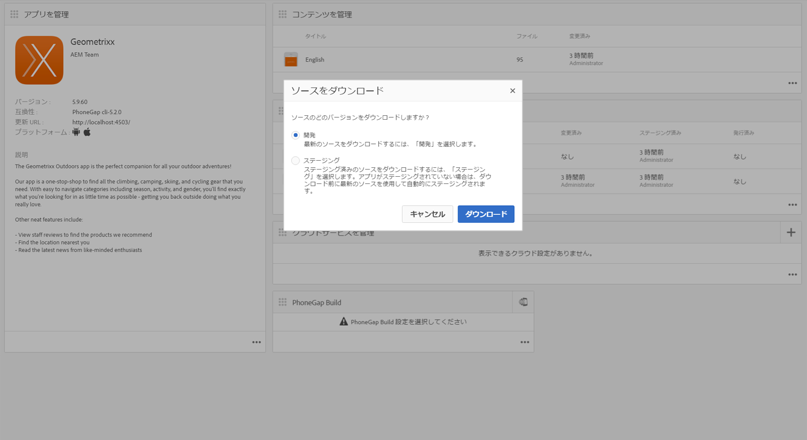

# ハイブリッドアプリでAdobe Experience Manager Mobileを利用する準備ができましたか？{#is-your-hybrid-app-ready-for-aem-mobile}

{{ue-over-mobile}}

ハイブリッド PhoneGapまたはCordova アプリをAEMに読み込んだので、次は何を実行しますか？ アプリにオーサブルコンテンツを追加する場合に最適です。 このタスクを実行するには、AEM アプリの構造に関する一般的な理解が必要です。 AEMのアプリは一般にふたつの部分に分かれています。 「シェル」と「コンテンツ」です。 「シェル」は、PhoneGap設定ファイル、アプリフレームワーク、ナビゲーションコントロールなど、アプリの静的部分で構成されます。 インポートしたアーカイブの内容は、シェルの一部として保存されます。 このドキュメントのコンテキストでは、シェルは、アプリ開発者が作成したHybrid PhoneGap アプリのAEM以外で作成されたすべてのコンテンツです。

コンテンツとは、AEM Developerによって構築されたAEMで作成されたコンポーネント、テンプレート、オーサリングページを指します。 コンテンツは、開発者コンテンツまたはオーサリングコンテンツとして分類されます。 コンポーネント、デザイン、ページテンプレートは、開発者が作成したものなので、開発コンテンツとみなされます。 Author-contentsは、コンポーネントとテンプレートを使用して作成されたページです。 これらのページは通常、Designerまたはマーケターが作成します。

ハイブリッド版アプリに作成済みのAEM ページを追加するには、アプリ開発者とAEM開発者の調整が必要です。 アプリ内でオーサリングされたコンテンツを追加する場合、アプリ開発者は、Experience Managerでオーバーレイできる構造でこれらのページを整理する必要があります。 アプリ開発者は、Experience Managerで作成されたコンテンツが追加される場所へのパスをExperience Manager開発者に提供できる必要があります。 次に、Experience Manager開発者がページコンテンツを作成した後に置き換えられるプレースホルダーページをハイブリッドアプリで指定します。

説明を簡単にするために、AEM Experience Cloudが使用されています。AEM Mobile ハイブリッドリファレンスを使用して、コンセプトを説明します。 ハイブリッドリファレンスアプリは、サイドメニュー付きのウェルカムページで構成されます。

この例では、アプリケーションのようこそページを作成します。 ソース [https://github.com/Adobe-Marketing-Cloud-Apps/aem-mobile-hybrid-reference/blob/master/hybrid-app/www/js/app.js#L75](https://github.com/Adobe-Marketing-Cloud-Apps/aem-mobile-hybrid-reference/blob/master/hybrid-app/www/js/app.js#L75)を参照しています。 アプリ開発者がウェルカムページを定義し、アプリによってレンダリングされるページのテンプレートを提供していることに注意してください。 アプリ開発者とAEM開発者が連携する必要があります。 ハイブリッド参照アプリのウェルカムページテンプレートへのパスは、「content/mobileapps/hybrid-reference-app/en/welcome.template.html」として定義されます。 AEM開発者は、同じパスを使用してAEM リポジトリ内のウェルカムページをオーサリングするので、このパスは重要です。

ハイブリッドアプリとAEMで作成されたコンテンツは、同じパスを使用することが重要です。これは、コンテンツシンクを使用してコンテンツをオーバーレイし、ハイブリッドアプリに新しいページを追加する機能に依存しているためです。 ハイブリッドアプリをAEMに読み込むと、インポートプロセスの一部としてContent Sync設定が設定されます。

アプリダッシュボードから「Sourceをダウンロード」すると、これらのContentSync スクリプトが実行され、ハイブリッドアプリのアーカイブが作成されます。

ContentSyncは最初にアプリの「シェル」を引き出します。これは、ハイブリッドアプリのアプリ開発コンテンツがすべて保存される場所です。 そして、アプリの「コンテンツ」を取り込みます。 これで、「コンテンツ」と同じパスを持つ「シェル」内のページがある場合、「シェル」の下のページは「コンテンツ」の下のページに（置き換えられます）。 そのため、ハイブリッド参照アプリのサンプルでは、「content/mobileapps/hybrid-reference-app/en/welcome.template.html」と同じパスを持つAEMでページが作成された場合、ContentSyncが実行されると、ハイブリッド参照アプリの一部であったページがオーバーレイされます。 その場所にAEMにあるものを置いてオーバーレイします。 オーバーレイはContentSyncによって管理されるので、アプリを使用しているユーザーは、AEMで作成されたコンテンツを使用してアプリを更新すると、シームレスに見え、アプリを再構築する必要はありません。 その結果、アプリを実行すると、ようこそページが次のように表示されます。

