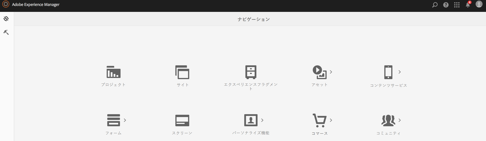
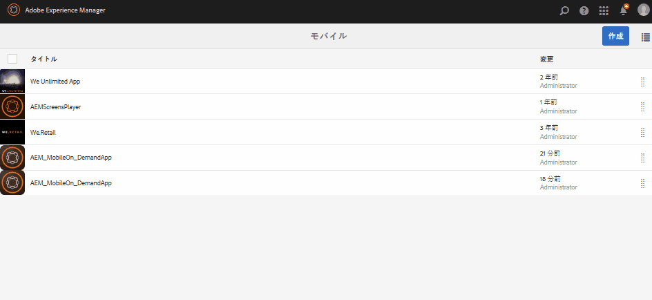

# アプリの定義{#app-definitions}

{{ue-over-mobile}}

アプリ定義は、アプリに適したスペースやその他の設定を特定する方法です。 アプリ定義を使用すると、ユーザーはアプリを再コンパイルすることなくスペースを追加できます。 アプリ定義が更新され、新しいスペースの情報が含まれます。

>[!NOTE]
>
>アプリ定義はアプリに関連付けられているため、AEM Mobile アプリコンソールでアプリを作成する必要があります。

## 新しいアプリ定義の作成 {#creating-a-new-app-definition}

1. AEM ナビゲーションコンソールから「**Mobile**」を選択します。

   

1. **モバイル**&#x200B;から&#x200B;**アプリ**&#x200B;を選択し、**作成**&#x200B;をクリックします。

   に&#x200B;**アプリ**&#x200B;を選択し、詳細を入力して新しいアプリを作成します。

   

### 次の手順 {#the-next-steps}

アプリ定義について理解したら、次のオーサリングリソースについて詳しく説明します。

* [既存のハイブリッドアプリの読み込み](/help/mobile/phonegap-adding-content-to-imported-app.md)
* [アプリの作成ウィザードを使用した新しいアプリの作成](/help/mobile/phonegap-create-new-app.md)
* [コンテンツサービス](/help/mobile/develop-content-as-a-service.md)

## その他のリソース {#additional-resources}

管理者と開発者の役割と責任について詳しくは、以下のリソースを参照してください。

* [AEMを使用したAdobe PhoneGap Enterpriseの開発](/help/mobile/developing-in-phonegap.md)
* [AEM を使用した Adobe PhoneGap Enterprise のコンテンツの管理](/help/mobile/administer-phonegap.md)
