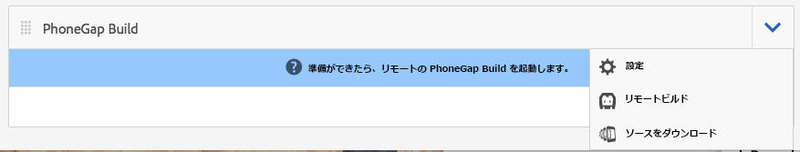
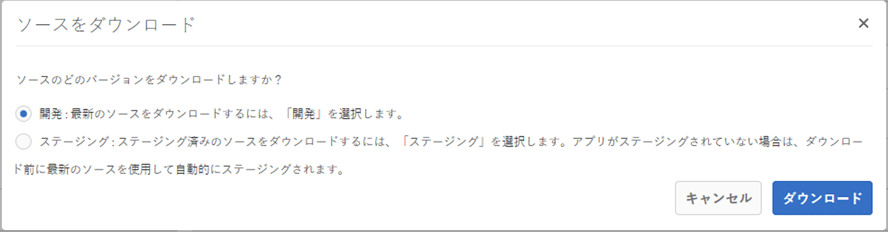
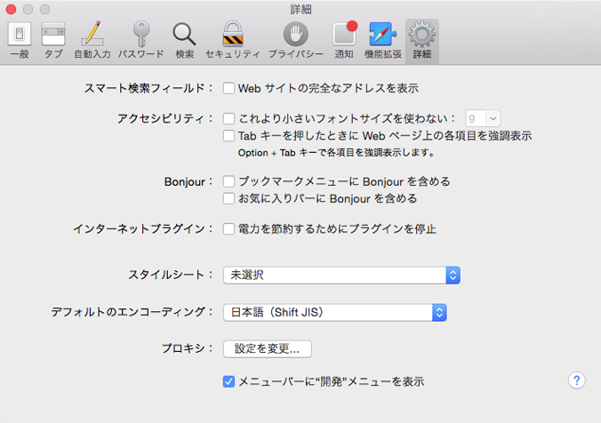
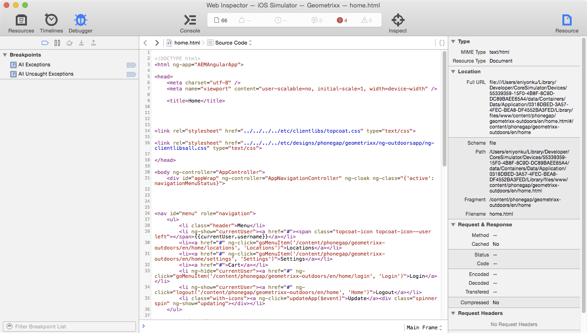
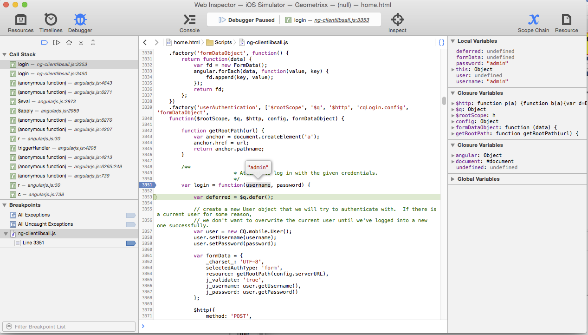
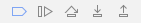

# PhoneGap CLI によるアプリの開発{#developing-apps-with-phonegap-cli}

{{ue-over-mobile}}

開発者は、開発環境を設定していれば、いつでもデバイス上またはエミュレーター内でアプリを実行できます。

次の例を実行するには、Xcodeを使用してmacOS Xを実行するシステム、またはAndroid™ SDKをインストールしたMac/Win/Linux システムが必要です。

## 開発環境のBootstrap {#bootstrap-your-development-environment}

PhoneGap CLIの設定（`https://docs.phonegap.com/en/4.0.0/guide_cli_index.md.html#The%20Command-Line%20Interface`）

IOSの場合：iPhoneとiPad向けに開発するには、AppleのXcode IDEが必要です。

* 無料で[こちら](https://idmsa.apple.com/IDMSWebAuth/signin?appIdKey=891bd3417a7776362562d2197f89480a8547b108fd934911bcbea0110d07f757&path=%2Fdownload%2F&rv=1)からダウンロードできます。
* PhoneGap iOS プラットフォームガイド （`https://docs.phonegap.com/en/4.0.0/guide_platforms_ios_index.md.html#iOS%20Platform%20Guide`）

Android™の場合：iPhoneとiPad向けに開発するには、GoogleのAndroid™ Studio IDEが必要です。

* 無料で[こちら](https://developer.android.com/studio)からダウンロードできます。
* PhoneGap Android™ プラットフォームガイド （`https://docs.phonegap.com/en/4.0.0/guide_platforms_android_index.md.html#Android%20Platform%20Guide`）

## Sourceをダウンロード {#download-the-source}

開発環境のブートストラップが正常に完了したら、AEM App Build Tileからソースをダウンロードします。

* 「PhoneGap Build tile」ドロップダウンシェブロンをクリックします。



* 「Sourceをダウンロード」をクリックします。
* 「Sourceをダウンロード」モーダルから目的のソースを選択します。



>[!NOTE]
>
>開発ソースには、ステージングされていない変更を含めながら、アプリの最新の状態が含まれます。 アプリ ストア ベンダーに送信するためのリリース候補を構築するために、ステージング ソースを使用します。
>
>アプリをステージングしない場合は、「ステージングトリガー」を選択してステージングワークフローを実行します（ヒント：AppStoreおよびGoogle PlayStoreで利用可能なPhoneGap Enterprise Viewer アプリにステージング済みアプリとして表示されます）。

* 「ダウンロード」をクリックし、ZIP ファイルをコンピューターに保存します。
* ダウンロードしたzip ファイルをワークスペースに抽出します。

## アプリのビルドと読み込み（ソースから） {#build-and-load-the-app-from-source}

PhoneGap CLIでは、プラットフォームプロジェクトの作成、ソースのコンパイル、アプリのデプロイを1つのコマンドで実行できます。

>[!NOTE]
>
>これらの手順はすべて個別に実行できます。詳しくは、PhoneGap CLI ドキュメント （`https://phonegap.com/blog/2014/11/13/phonegap-cli-3-6-3/`）を参照してください。

1. PhoneGap CLIがインストールされていることを確認します。上記を参照してください。
1. コンソール（またはターミナル）ウィンドウで、抽出したソースのルートディレクトリに移動します。
1. 以下のコマンドを入力します。

```xml
phonegap run android

// -- or -- //

phonegap run ios
```

>[!NOTE]
>
>この時点で問題が発生した場合は、基本に戻ってトラブルシューティング -
>
>1. フォルダーの作成（mkdir テスト）
>1. この新しいフォルダーに移動します（CD テスト）
>1. `phonegap create helloWorld` を実行します
>1. helloWorldへの移動（cd helloWorld）
>1. `phonegap run android`を実行します（または、上記のようにAndroidをiOSに置き換えます™。）。
>1. JavaScript Bridgeからネイティブへの移行が有効な場合は、「Device Ready」と表示され、新しく作成したPhoneGap アプリを実行するエミュレーターが開きます。
>
>このトラブルシューティングは、PhoneGap CLI開発環境が正しく動作していることを確認します。

## SafariおよびIOSでのJavaScriptのデバッグ デバッグ {#debug-javascripts-with-safari-and-ios-debug}

Web アプリケーションと同じように、Safariのデベロッパーツールを使用してアプリのJavaScriptをデバッグできます。

## Safari開発者ツールを有効にする {#enable-safari-developer-tools}

開発者ツールを有効にするには：

* Safariの環境設定を開きます

  * メニューバーの「Safari」をクリックします
  * 「環境設定」をクリック

* 「環境設定」ウィンドウで「詳細」をクリックします



* 「メニューバーに現像メニューを表示」にチェックを入れる
* 環境設定ウィンドウを閉じる

## SafariとiOSの連携 {#connect-safari-to-ios}

Safariは、iOS デバイスまたはエミュレーターに接続できます。

* コンソールウィンドウで、抽出したソースのルートディレクトリに移動します。
* 次のコマンドを入力して、デバイスまたはエミュレーターでアプリを起動します。

```xml
phonegap run <platform> --device

// -- or -- //

phonegap run <platform> --emulator
```

* Safariを開く
* メニューバーの「現像」をクリックします
* IOS Simulator サブメニューを選択
* ホーム.htmlをクリック



## SafariのWeb インスペクターを使用したJavaScriptのデバッグ {#debug-javascript-with-safari-s-web-inspector}

ソース内の任意の場所にブレークポイントを設定できます。 エミュレーターまたはデバイスを操作すると、アプリの実行はそれらのブレークポイントで停止します。 実行をステップスルーし、変数の値を検査できます。

* Web インスペクターウィンドウの「リソース」をクリックします
* ソースツリーに移動し、目的のソースファイルをクリックします
* ブレークポイントを追加するには、横の行番号をクリックします
* デバイスまたはエミュレーターとの対話



* コントロールボタンを使用して、実行を続行し、ステップオーバー、ステップイン、ステップアウトの各メソッドを実行します。



>[!NOTE]
>
>現在のメソッドの変数の値を表示するには、マウスを置きます。

## 次の手順 {#the-next-steps}

PhoneGap CLIを使用したアプリの開発について学習した後、[ デバイス機能へのアクセス ](/help/mobile/phonegap-access-device-features.md)を参照してください。
