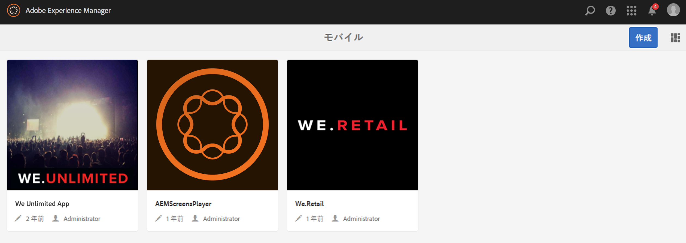
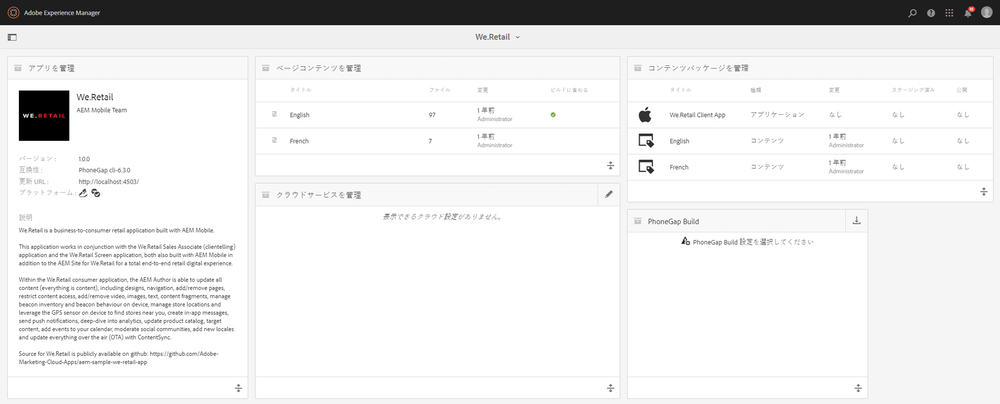
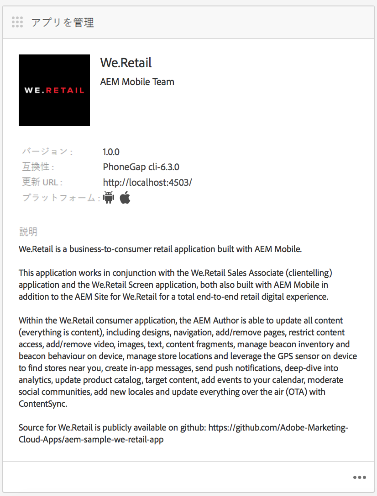
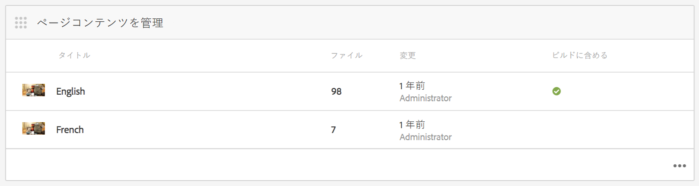
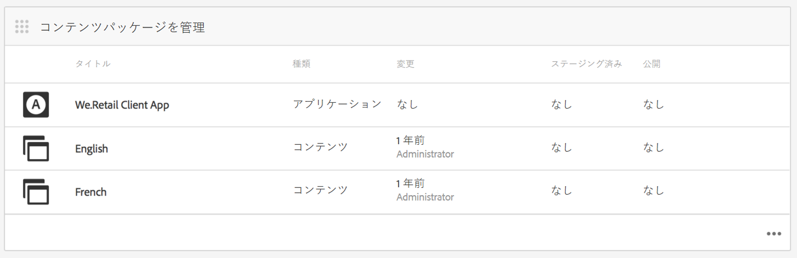
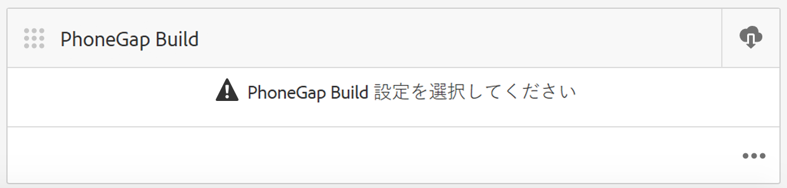
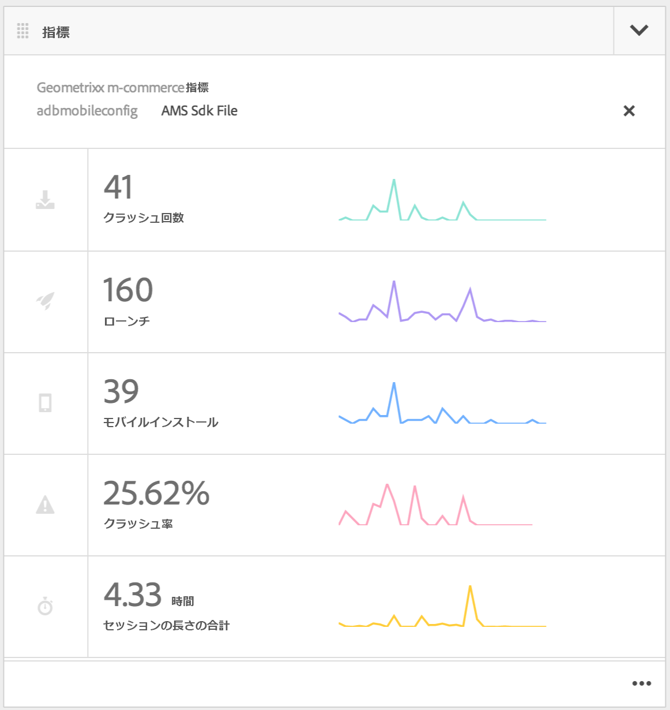
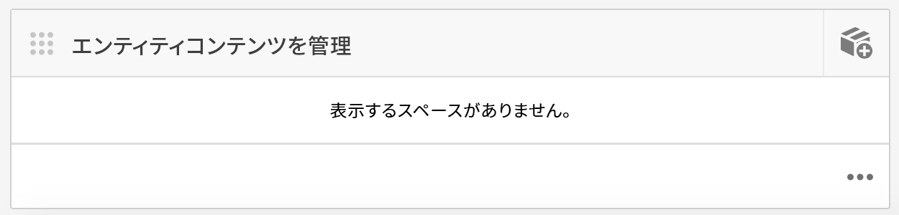

# モバイルアプリケーションのオーサリング{#authoring-mobile-applications}

{{ue-over-mobile}}

AEM Mobile ダッシュボードでは、モバイルアプリケーションの作成、構築、デプロイ、アプリケーションのメタデータの作成、削除、編集を行うことができます。 アプリケーションが公開されたら、ライフサイクルや利用指標を含むアプリケーション分析を分析して、顧客コンバージョンとブランドロイヤルティを向上させることができます。

AEM Mobile アプリケーションを作成するには、[&#x200B; モバイルアプリケーションの作成](/help/mobile/building-app-mobile-phonegap.md) ページを参照してください。

環境を設定して開始するには、[AEM PhoneGap Enterpriseを使用するためのAEMの管理](/help/mobile/administer-phonegap.md)を参照してください。

## AEM Mobile アプリカタログ {#the-aem-mobile-apps-catalog}

[AEM Mobile Apps カタログ &#x200B;](http://localhost:4502/aem/apps.html/content/phonegap)には、AEMで管理されているすべてのモバイルアプリが表示されます。

このカタログは、AEM Mobileの「ランディングページ」と考えてください。管理者は、テンプレートに基づいて作成するか、モバイル開発者によって既に開始されている既存のアプリをアップロードすることで、新しいAEM Mobile アプリケーションを開始できます。

アプリカタログランディングページにアクセスするには、次の手順に従います。

1. **ナビゲーション**&#x200B;を参照し、**モバイル**&#x200B;を選択します。

1. **アプリ**&#x200B;を選択して、アプリカタログを開きます。

## AEM Mobileアプリダッシュボード {#the-aem-mobile-app-dashboard}

カタログからAEM Mobile アプリを選択すると、そのダッシュボードが表示されます。 ここでは、アプリケーションの管理、統計情報の表示、モバイルアプリのコンテンツの構築、デプロイ、管理を行うことができます。

AEM Mobile ダッシュボードの各タイルに展開し、右下隅にある「。..」をクリックして詳細を表示または編集できます。

### アプリを管理タイル {#the-manage-app-tile}

アプリを管理タイルには、アプリケーションのアイコン、名前、説明、サポートされているプラットフォーム、アップデート URLとバージョン情報のコールホームが表示されます。 このタイルをドリルダウンして、PhoneGap アプリケーション設定（config.xml）を編集および管理し、様々なアプリケーションストアに送信して配布できるようにアプリケーションを準備することができます。

詳細については、[こちら](/help/mobile/phonegap-app-details-tile.md)をクリックしてください。

### ページコンテンツを管理タイルを使用すると {#the-manage-page-content-tile}

AEM Mobileでは、AEM Sitesと同様にコンテンツを作成、更新、削除できます。 **ページコンテンツタイルを管理**&#x200B;すると、管理されたコンテンツと最終更新日のページ数が表示されます。 コンテンツをドリルダウンして、タイルの各レコードをクリックすることで、ページを作成、コピー、移動、削除、更新できます。 コンテンツが更新されたら、**コンテンツパッケージの管理タイル**&#x200B;を通じて、コンテンツの更新を顧客にプッシュできます。

### 「コンテンツパッケージを管理」タイル {#the-manage-content-packages-tile}

ページコンテンツ管理タイルを使用してコンテンツを追加または変更したら、コンテンツリリースのアップデートを使用して、これらの変更を顧客にプッシュできます。

Content Packageを使用すると、AEM App AuthorはAEMでページコンテンツを管理し、開発部門にPhoneGap Shell Application （つまり、アプリフレームワークまたはインフラストラクチャ）を変更してもらい、それらの変更を迅速に顧客にプッシュします。開発者に依頼して配布するためのさまざまなストアに再送信する必要はありません。

コンテンツパッケージは、更新ごとにコンテンツリリースパッケージと見なされるZIP ファイルを作成します。 これらのパッケージには、アプリのレンダリング中に生成されるhtml リソースとhtml ページが含まれており、前回の更新以降に変更されたファイルのみをパッケージ化するのに十分なインテリジェンスを備えています。

コンテンツパッケージタイルの&#x200B;**Type**&#x200B;列には、アプリケーションシェルのコンテンツを示す「アプリ」が表示されます。例えば、開発者が管理するアプリのフレームワークやインフラストラクチャ、コンテンツ作成者が管理するページコンテンツを表す「コンテンツ」などがあります。

コンテンツは、言語またはアプリの特定の部分として表すことができ、複数のコンテンツリリースパッケージがアプリによって消費されます。 コンテンツのバンドル方法の選択は柔軟で、アプリケーションのコンテンツの管理方法に完全に依存しています。

**Modified**&#x200B;列は、ページが最近変更された日時を示します。

**ステージング済み**&#x200B;列には、コンテンツの最後の更新がいつ作成されたかが表示されます。 コンテンツ更新を作成して変更をステージングするには、タイル内の任意のレコードを開いて更新を作成します。

**公開済み**&#x200B;列には、最後のコンテンツ更新が公開され、顧客が利用できるようになった日時が表示されます。 コンテンツを公開するには、最初にそのコンテンツをステージングし、次にこのタイルをドリルダウンしてコンテンツリリースの詳細コンソールから公開して、更新を公開する必要があります。

 

このアイコンは、アプリシェルのコンテンツリリースパッケージを表します

これらのアイコンは、アプリコンテンツのコンテンツリリースパッケージを表します

### PhoneGap ビルドタイル {#the-phonegap-build-tile}

**PhoneGap Build Tile**&#x200B;は、`https://build.phonegap.com`と接続してリモート ビルドをビルドおよびホストします。 ビルドが作成されると、ビルドはダウンロードまたはQR コードを介してお使いのデバイスに直接提供されます。

または、デバイス ソースをダウンロードして、PhoneGap CLI （`https://docs.phonegap.com/en/3.5.0/guide_cli_index.md.html`）を使用してローカルでビルドすることもできます。

### 指標タイル {#the-metrics-tile}

>[!CAUTION]
>
>指標タイルは、クラウドサービスを設定した後にのみ表示されます。
>
>詳しくは、[Adobe Mobile Services Cloud Service](/help/mobile/configure-adobe-mobile-cloud-service.md)の設定を参照してください。

AEM Mobileは、[Adobe Mobile Services SDK](https://experienceleague.adobe.com/docs/mobile.html?lang=ja) （AMS）を通じてAdobe Analyticsと統合されます。

コントロールセンター&#x200B;**指標タイル**&#x200B;には、アプリケーションのAMSから取得したサマリー分析が表示されます。 右下の「。..」をクリックすると、分析ダッシュボードをドリルダウンできます。

### エンティティコンテンツを管理タイル {#the-manage-entity-content-tile}

エンティティ コンテンツを管理タイルを使用すると、アプリ定義を追加および管理できます。 アプリ定義は、アプリに適したスペース（およびその他の設定）を特定する方法です。 これにより、アプリを再コンパイルすることなく、新しいスペースを追加できます。 アプリ定義が更新され、新しいスペースの情報が含まれます。

アプリ定義を作成および管理するには、[ここ](/help/mobile/phonegap-app-definitions.md)をクリックします。

エンティティ管理コンテンツダッシュボードをドリルダウンするには、右下の「。..」をクリックします。

#### その他のリソース {#additional-resources}

管理者と開発者の役割と責任について詳しくは、以下のリソースを参照してください。

* [AEMを使用したAdobe PhoneGap Enterpriseの開発](/help/mobile/developing-in-phonegap.md)
* [AEM を使用した Adobe PhoneGap Enterprise のコンテンツの管理](/help/mobile/administer-phonegap.md)
