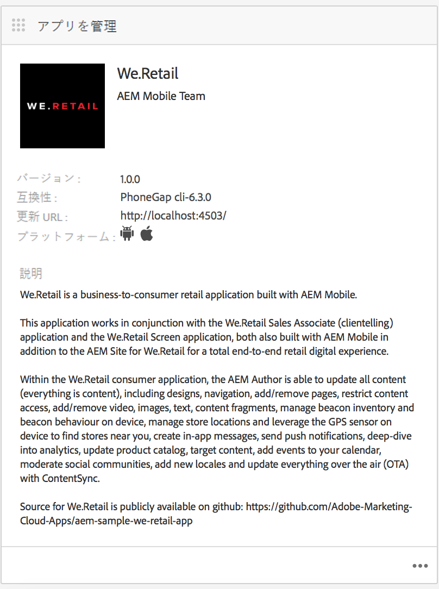
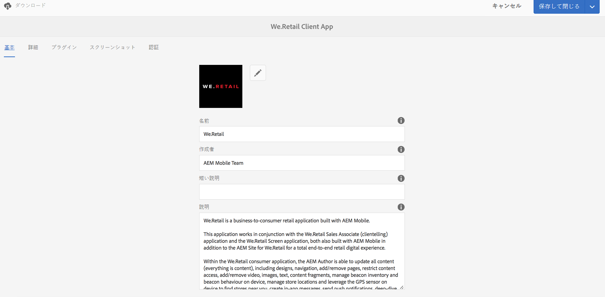
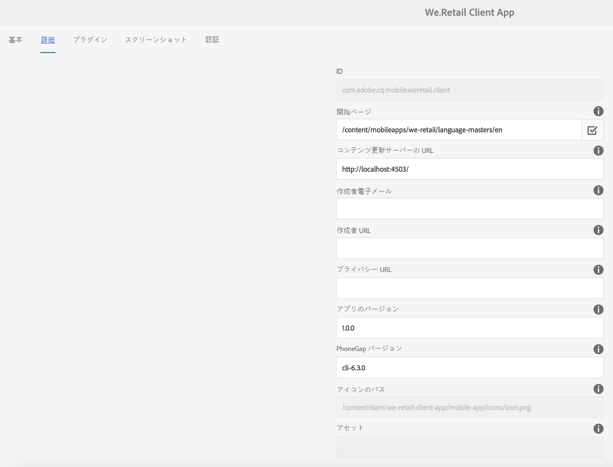
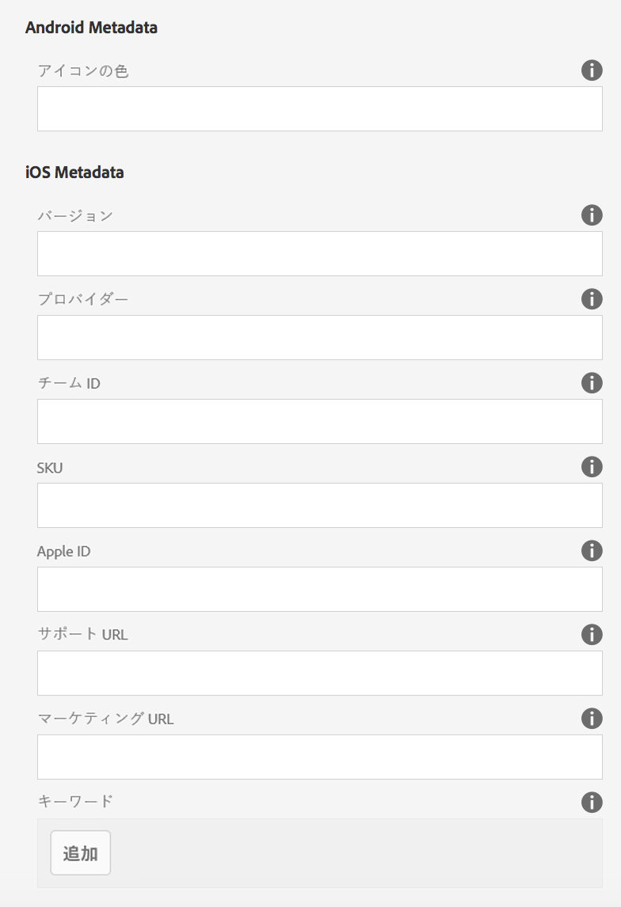
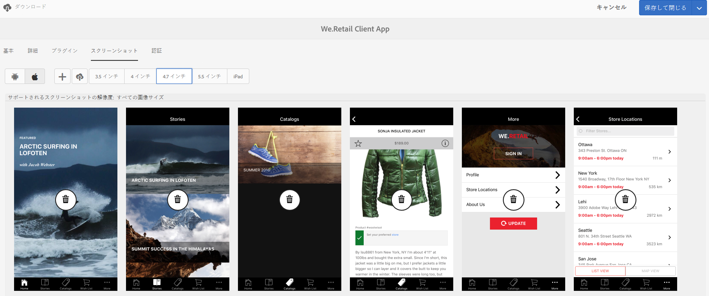
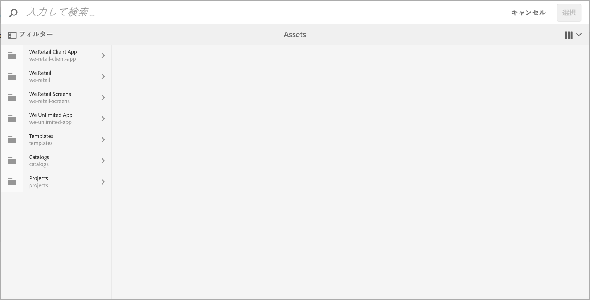
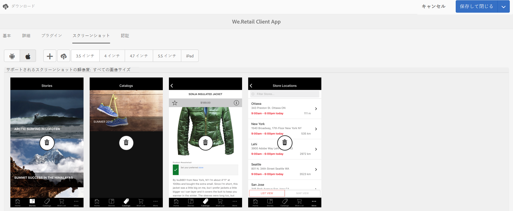

# アプリのメタデータの編集 {#editing-app-metadata}

{{ue-over-mobile}}

**アプリの管理** タイルと「アプリの管理」ページには、アプリケーションのメタデータを表示および編集するための手段が用意されています。 アプリケーションのメタデータは、アプリケーションをベンダーのストアにリリースするために必要な詳細です。 これには、一般的なメタデータ、iOSのメタデータ、スクリーンショットが含まれます。 共通およびiOS メタデータの詳細については、[&#x200B; アプリ タイルの管理](/help/mobile/phonegap-app-details-tile.md)を参照してください。

## アプリデータの編集 {#editing-the-app-data}

アプリのメタデータを編集するには：

1. アプリのダッシュボードページに移動します。

   

1. 詳細を表示または編集するには、**アプリを管理** タイルの右下隅にある「。..」をクリックします。

1. 次の図に示すように、5つのタブで詳細を入力または表示します。

   

## 共通およびIOS メタデータの編集 {#editing-common-and-ios-metadata}

共通およびIOS メタデータを編集できます。

* アプリの説明ページから「**詳細**」タブを選択します。
* 共通およびIOS メタデータを編集または表示します。 詳しくは、以下の図を参照してください。

 

## スクリーンショットの追加と削除 {#add-and-remove-screenshots}

アプリのスクリーンショットをメタデータロールアップに含めることができます。 一部のベンダーは、アプリをアプリストアに送信する際に、正確なスクリーンショットを必要とします。 これらの画像は、Assetsに既に存在している必要があります。 スクリーンショットをアップロードするには、[&#x200B; アセットピッカー](../assets/search-assets.md#assetpicker)を参照してください。

### スクリーンショットを追加 {#add-screenshots}

アセットをスクリーンショットとして追加するには：

1. **アプリを管理** ページの編集モードで、「追加」（プラスアイコン）をクリックします。
1. アセットを選択し、**選択**&#x200B;をクリックしてアセットを追加します。

   

1. アセットを選択し、**選択**&#x200B;をクリックしてアセットを追加します。

>[!NOTE]
>
>スクリーンショットは、ターゲットデバイスの画面解像度と一致している必要があります。

### Screenshotsの削除 {#delete-screenshots}

スクリーンショットを削除するには：

アセットの削除をクリックします。

## 次の手順 {#the-next-steps}

その他のオーサリングの役割について詳しくは、次のリソースを参照してください。

* [アプリを管理タイル](/help/mobile/phonegap-app-details-tile.md)
* [アプリ定義](/help/mobile/phonegap-app-definitions.md)
* [アプリ作成ウィザードを使用した新しいアプリの作成](/help/mobile/phonegap-create-new-app.md)
* [既存のハイブリッドアプリの読み込み](/help/mobile/phonegap-adding-content-to-imported-app.md)
* [コンテンツサービス](/help/mobile/develop-content-as-a-service.md)

### その他のリソース {#additional-resources}

管理者と開発者の役割と責任について詳しくは、以下のリソースを参照してください。

* [AEMを使用したAdobe PhoneGap Enterpriseの開発](/help/mobile/developing-in-phonegap.md)
* [AEM を使用した Adobe PhoneGap Enterprise のコンテンツの管理](/help/mobile/administer-phonegap.md)
