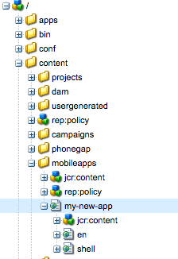

# アプリの構造{#structure-an-app}

{{ue-over-mobile}}

AEM Mobile プロジェクトには、ページ、JavaScriptおよびCSS クライアントライブラリ、再利用可能なAEM コンポーネント、Content Sync設定、PhoneGap アプリシェルのコンテンツなど、様々なコンテンツタイプが含まれます。 新しいAEM Mobile アプリを[ スターターキット ](https://github.com/Adobe-Marketing-Cloud-Apps/aem-phonegap-starter-kit)に基づいて作成することは、様々な種類のコンテンツをすべて推奨の構造に取り込み、長期的な持ち運びとメンテナンス性の両方を容易にするための優れた方法です。

## ページコンテンツ {#page-content}

アプリケーションのすべてのページは、AEM Mobile コンソールで認識できるように、/content/mobileappsの下に配置する必要があります。

AEMの規則では、アプリの最初のページは、アプリのデフォルト言語として機能する子ページの1つにリダイレクトする必要があります（Geometrixxとスターターキットの両方の場合は「en」）。 トップレベルのロケールページは通常、オーバーザエアのContent Sync アップデートのインストールに必要な初期化を処理する基盤「splash-page」コンポーネント（/libs/mobileapps/components/splash-page）から継承します（contentInit コードは/etc/clientlibs/mobile/content-sync/js/contentInit.jsにあります）。

## テンプレートとコンポーネント {#templates-and-components}

アプリのテンプレートとコンポーネントコードは/apps/&lt; ブランド名>/&lt; アプリ名>にする必要があります。 規則に従って、テンプレートとコンポーネントコードを/apps/&lt; ブランド名>/&lt; アプリ名>に配置する必要があります。 このパターンは、AEMで既にSiteを使用している開発者に慣れ親しんでいる必要があります。 通常は、パブリッシュインスタンスで/apps/がデフォルトで匿名アクセスにロックダウンされているので、この設定に従います。 そのため、生のJSP コードは潜在的な攻撃者から隠されています。

アプリ固有のテンプレートは、テンプレート自体で`allowedPaths` プロパティノードを使用し、その値を&#39;/content/mobileapps （/.&amp;ast;）?&#39;に設定することによってのみ表示されるように設定できます。テンプレートが単一のアプリでのみ使用できる場合は、さらに具体的な設定も可能です。 `allowedParents`および`allowedChildren` プロパティは、作成者が新しいページを作成する場所に基づいて利用できるテンプレートを詳細に制御するために使用することもできます。

アプリページコンポーネントをゼロから作成する場合は、その`sling:resourceSuperType` プロパティを「mobileapps/components/angular/ng-page」に設定することをお勧めします。 これにより、オーサリングとレンダリングの両方を単一ページアプリとして行うためのページが設定され、コンポーネントを変更する必要がある.jsp ファイルをオーバーレイできるようになります。 ng-pageにはUI フレームワークがまったく含まれていないため、開発者は通常、（少なくとも）「template.jsp」（/libs/mobileapps/components/angular/ng-page/template.jspからオーバーレイ）をオーバーレイすることになります。

AngularJSを使用したいオーサリング可能なページコンポーネントには、/libs/mobileapps/components/angular/ng-componentに同等の`sling:resourceSuperType` コンポーネントがあり、同じ方法でオーバーレイおよびカスタマイズできます。

## JavaScriptとCSS Clientlibs {#javascript-and-css-clientlibs}

クライアントライブラリには、開発者がリポジトリ内のどこに配置するかを指定できるオプションがいくつかあります。 以下のパターンはガイダンス用に提供されますが、厳密な要件ではありません。

クライアントサイドコードが単独で動作でき、アプリケーションの特定のコンポーネントに関係しない場合（つまり、他のアプリケーションで再利用される場合がある場合）、Adobeでは/etc/clientlibs/&lt; ブランド名>/&lt; ライブラリ名>に格納することをお勧めします。 一方、clientlibが1つのアプリケーションに固有の場合は、アプリケーションのデザインノードの子としてネストできます。/etc/designs/phonegap/&lt; ブランド名>/&lt; アプリ名>/clientlibs。 このclientlibのカテゴリを他のlibsと一緒に使用しないでください。代わりに、必要に応じて他のlibsを埋め込んでください。 このパターンに従うと、クライアントライブラリがアプリに追加されるたびに、開発者が新しいコンテンツ同期設定を追加する必要がなくなり、アプリのデザインクライアントライブラリの「埋め込み」プロパティを更新するだけです。 例えば、/content/phonegap/geometrixx-outdoors/en/jcr:content/page-app/app-config/clientlibs-allにあるGeometrixx clientlibs-all Content Sync config ノードを見てください。

クライアントサイドのコードが特定のコンポーネントと密接に結合されている場合は、そのコードを/apps/内のコンポーネントの場所の下にネストされたクライアントライブラリに配置し、そのカテゴリをアプリの「デザイン」 clientlibに埋め込みます。

## PhoneGap設定 {#phonegap-configuration}

各AEM Mobile アプリには、Web コンテンツを実行可能なアプリケーションに変換するために`https://build.phonegap.com/`のPhoneGap [ コマンドラインインターフェイス ](https://github.com/phonegap/phonegap-cli)およびPhoneGap ビルドで使用される設定ファイルをホストするディレクトリが含まれています。 例えば、Geometrixx サンプルでは、このディレクトリ（/content/phonegap/geometrixx-outdoors/shell/jcr:content/page-app/app-content）がシェルの一部として配置されています。デバイス APIやアプリ自体の設定を扱うプラグインなど、無線で更新できないコンテンツのみが含まれているため、デザインが決定されました。

このディレクトリには、プラグインのインストール、プラットフォーム固有の場所へのリソースファイルの配置、ビルドの一部として実行されるその他のアクションに使用できる[Cordova フック ](https://cordova.apache.org/docs/en/dev/guide/appdev/hooks/index.html#Hooks%20Guide)もあります。 注：ビルドの一部として各プラグインをダウンロードする代わりに、Kitchen Sink アプリのパターンに従い、プラグインソースコード <!-- THIS URL IS 404 (https://github.com/blefebvre/aem-phonegap-kitchen-sink/tree/master/content/src/main/content/jcr_root/content/phonegap/kitchen-sink/shell/_jcr_content/pge-app/app-content/phonegap/plugins) -->をアプリプロジェクトの残りの部分に含めることができます。

## 次の手順 {#the-next-steps}

アプリの構造について説明したら、[App Consoleを使用したアプリの作成と編集](/help/mobile/phonegap-apps-console.md)を参照してください。
