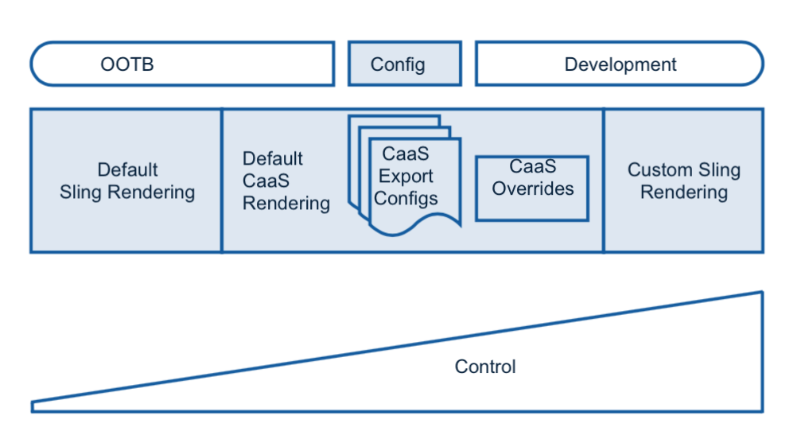

# レンダリングと配信{#rendering-and-delivery}

{{ue-over-mobile}}

Adobe Experience Manager（AEM）コンテンツは、[Sling Default Servlets](https://sling.apache.org/documentation/bundles/rendering-content-default-get-servlets.html)を介して簡単にレンダリングし、[JSON](https://sling.apache.org/documentation/bundles/rendering-content-default-get-servlets.html#default-json-rendering)およびその他の形式でレンダリングできます。

これらのレンダリングは通常、リポジトリを移動し、そのままコンテンツを返します。

AEMでは、Slingを使用して、レンダリングされたスキーマとコンテンツを完全に制御するカスタムスリングレンダラーの開発とデプロイもサポートしています。

コンテンツサービスのデフォルトレンダラーは、すぐに使えるSlingのデフォルトとカスタム開発のギャップを埋め、開発なしでレンダリングされたコンテンツの多くの側面のカスタマイズと制御を可能にします。

次の図は、コンテンツサービスのレンダリングを示しています。

## JSONの要求 {#requesting-json}

**&lt;RESOURCE.caas`[.<EXPORT-CONFIG][.&lt;DEPTH-INT&gt;]`.json**&#x200B;を使用してJSONをリクエストします。

<table>
 <tbody>
  <tr>
   <td>リソース</td>
   <td>/content/entities または の下のエンティティリソース /contentの下のコンテンツリソース</td>
  </tr>
  <tr>
   <td>EXPORT-CONFIG</td>
   <td>
<strong> オプション </strong>  
 
/apps/mobileapps/caas/exportConfigs/EXPORT-CONFIG   で見つかった書き出し設定を省略すると、デフォルトの書き出し設定が適用されます 
 </td>
  </tr>
  <tr>
   <td>DEPTH-INT</td>
   <td>Sling レンダリングで使用される子のレンダリングに対する<strong> オプション </strong>   の深度再帰</td>
  </tr>
 </tbody>
</table>

## 書き出し設定の作成 {#creating-export-configs}

書き出し設定を作成して、JSON レンダリングをカスタマイズできます。

*/apps/mobileapps/caas/exportConfigsに設定ノードを作成できます。*

| ノード名 | 設定の名前（レンダリングセレクター用） |
|---|---|
| jcr:primaryType | nt:unstructured |

次の表に、Export Configsのプロパティを示します。

<table>
 <tbody>
  <tr>
   <td><strong>名前</strong></td>
   <td><strong>型</strong></td>
   <td><strong>デフォルト（設定しない場合）</strong></td>
   <td><strong>値</strong></td>
   <td><strong>説明</strong></td>
  </tr>
  <tr>
   <td>includeComponents</td>
   <td>String[]</td>
   <td>すべてを含める</td>
   <td>sling:resourceType</td>
   <td>sling:resourceTypeを指定したノードの詳細をJSON エクスポートから除外する</td>
  </tr>
  <tr>
   <td>excludeComponents</td>
   <td>String[]</td>
   <td>何も除外</td>
   <td>sling:resourceType</td>
   <td>sling:resourceTypeを指定したノードの詳細のみをJSON エクスポートから含めます</td>
  </tr>
  <tr>
   <td>excludePropertyPrefixes</td>
   <td>String[]</td>
   <td>何も除外</td>
   <td>プロパティプレフィックス</td>
   <td>指定された接頭辞で始まるプロパティをJSON エクスポートから除外</td>
  </tr>
  <tr>
   <td>excludeProperties</td>
   <td>String[]</td>
   <td>何も除外</td>
   <td>プロパティ名</td>
   <td>指定したプロパティをJSON エクスポートから除外する</td>
  </tr>
  <tr>
   <td>includeProperties</td>
   <td>String[]</td>
   <td>すべてを含める</td>
   <td>プロパティ名</td>
   <td>
excludePropertyPrefixes set の場合、これは、除外される接頭辞に一致するにもかかわらず、指定されたプロパティを含みます。
 
else （exclude properties ignored）には、これらのプロパティのみが含まれます
 </td>
  </tr>
  <tr>
   <td>includeChildren</td>
   <td>String[]</td>
   <td>すべてを含める</td>
   <td>子名</td>
   <td>指定された子をJSON エクスポートから除外</td>
  </tr>
  <tr>
   <td>excludeChildren</td>
   <td>String[]    </td>
   <td>何も除外</td>
   <td>子名</td>
   <td>JSON書き出しから指定された子のみを含め、その他を除外</td>
  </tr>
  <tr>
   <td>renameProperties</td>
   <td>String[]    </td>
   <td>名前を変更しない</td>
   <td>&lt;actual_property_name&gt;,&lt;replacement_property_name&gt;</td>
   <td>置換を使用したプロパティ名の変更</td>
  </tr>
 </tbody>
</table>

### リソースタイプの書き出しの上書き {#resource-type-export-overrides}

*/apps/mobileapps/caas/exportConfigsの下に設定ノードを作成します。*

| name | resourceTypeOverrides |
|---|---|
| jcr:primaryType | nt:unstructured |

次の表に、プロパティを示します。

<table>
 <tbody>
  <tr>
   <td><strong>名前</strong></td>
   <td><strong>型</strong></td>
   <td><strong>デフォルト（設定しない場合）</strong></td>
   <td><strong>値</strong></td>
   <td><strong>説明</strong></td>
  </tr>
  <tr>
   <td>&lt;SELECTOR_TO_INC&gt;</td>
   <td>String[] </td>
   <td>-</td>
   <td>sling:resourceType</td>
   <td>次のSling リソースタイプの場合、デフォルトのCaaS json エクスポートを返しません。  リソースをレンダリングして、顧客json エクスポートを返します。  &lt;RESOURCE&gt;.&lt;SELECTOR_TO_INC&gt;.json </td>
  </tr>
 </tbody>
</table>

### 既存のコンテンツサービス書き出し設定 {#existing-content-services-export-configs}

コンテンツサービスには、次の2つの書き出し設定が含まれます。

* デフォルト（設定が指定されていません）
* ページ（サイトページをレンダリングする）

#### デフォルトの書き出し設定 {#default-export-configuration}

Content Servicesのデフォルトの書き出し設定は、要求されたURIに設定が指定されている場合に適用されます。

&lt;RESOURCE>.caas[.&lt;DEPTH-INT>].json

<table>
 <tbody>
  <tr>
   <td><strong>名前</strong></td>
   <td><strong>値</strong></td>
  </tr>
  <tr>
   <td>excludeProperties</td>
   <td> </td>
  </tr>
  <tr>
   <td>excludePropertyPrefixes</td>
   <td>jcr:,sling:,cq:,oak:,pge-</td>
  </tr>
  <tr>
   <td>includeProperties</td>
   <td>jcr:text,text  jcr:title,title  jcr:description,description  jcr:lastModified,lastModified  cq:tags,tags  cq:lastModified,lastModified</td>
  </tr>
  <tr>
   <td>includeComponents</td>
   <td> </td>
  </tr>
  <tr>
   <td>excludeComponents</td>
   <td> </td>
  </tr>
  <tr>
   <td>includeChildren</td>
   <td> </td>
  </tr>
  <tr>
   <td>excludeChildren</td>
   <td> </td>
  </tr>
  <tr>
   <td>Sling JSON オーバーライド</td>
   <td>foundation/components/image  wcm/foundation/components/image  mobileapps/caas/components/data/contentReference  mobileapps/caas/components/data/assetlist</td>
  </tr>
 </tbody>
</table>

#### ページ書き出し設定 {#page-export-configuration}

この設定は、デフォルトを拡張して、子ノードの下に子をグループ化します。

&lt;SITE_PAGE>.caas.page[.&lt;DEPTH-INT>].json

### その他のリソース {#additional-resources}

コンテンツサービスのその他のトピックについては、以下のリソースを参照してください。

* [モデルの開発](/help/mobile/administer-mobile-apps.md)
* [コンテンツサービスのオーサリング](/help/mobile/develop-content-as-a-service.md)
* [コンテンツサービスの管理](/help/mobile/developing-content-services.md)
