# スペースとエンティティ{#spaces-and-entities}

{{ue-over-mobile}}

スペースは、Content Services REST APIを介して公開されるエンティティを保存するのに便利な場所です。 アプリ（または任意のチャネル）は、多くのエンティティに関連付けることができるため、この機能は特に便利です。 エンティティをスペース内に強制的に配置すると、アプリの要件をグループ化するベストプラクティスが適用されます。 必要に応じて、AEMのアプリを少数のスペースに関連付けることができます。

>[!NOTE]
>
>コンテンツサービスの任意のチャネルでコンテンツを利用できるようにするには、コンテンツを保管する必要があります。

## スペースの作成 {#creating-a-space}

利用者が、多数のコンテンツやアセットをモバイルアプリで公開したい場合は、AEM Mobileダッシュボードを使用してスペースを作成します。

スペースを操作するようにコンテンツサービスを設定していない初めてのユーザーの場合、**コンテンツサービス**&#x200B;を選択すると、AEM Mobile ダッシュボードにアプリのみが表示されます。

>[!CAUTION]
>
>**スペースを追加するための前提条件**
>
>「**AEM Content Servicesを有効にする**」でスペースを操作し、AEM Mobile アプリケーションダッシュボードで有効にします。
>
>詳しくは、[&#x200B; コンテンツサービスの管理](/help/mobile/developing-content-services.md)を参照してください。

ダッシュボードでスペースを設定したら、次の手順に従ってスペースを作成します。

1. Content Servicesから&#x200B;**スペース**&#x200B;を選択します。

   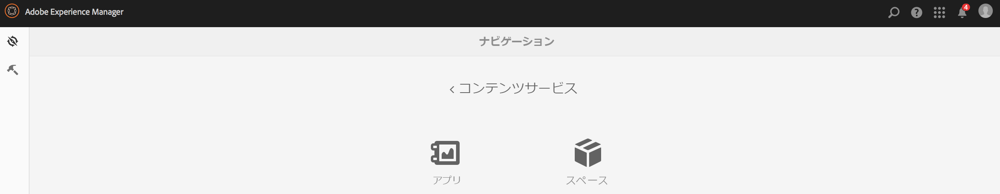

1. スペースを作成するには、**作成**&#x200B;を選択します。 スペースに「**タイトル**」、「**名前**」、「**説明**」と入力します。

   「**作成**」をクリックします。

   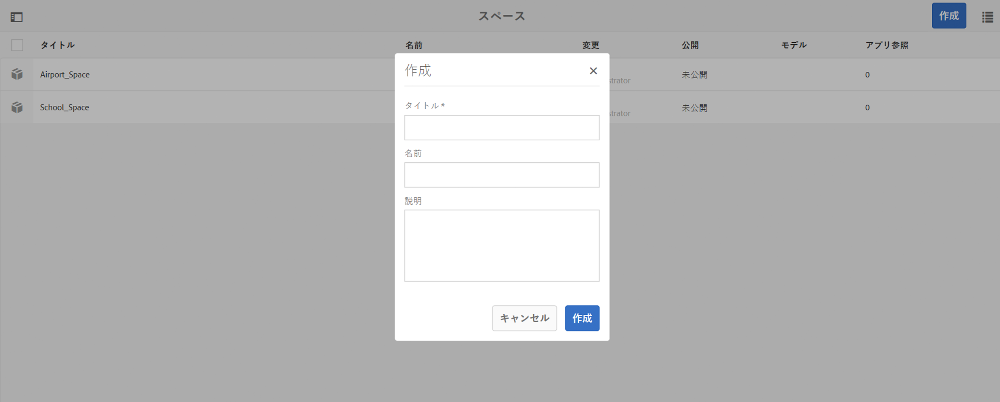

## スペースの管理 {#managing-a-space}

スペースを作成したら、左をクリックしてリスト内のスペースを管理します。

スペースのプロパティを表示したり、スペースを削除したり、スペースとその内容をAEM パブリッシュインスタンスにパブリッシュしたりできます。

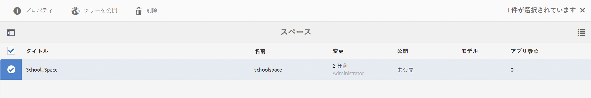

**スペースのプロパティの表示と編集**

1. リストからスペースを選択します
1. ツールバーから&#x200B;**プロパティ**&#x200B;を選択します
1. 完了したら、**閉じる**&#x200B;をクリックします

**スペースの公開** スペースが公開されると、そのスペース内のすべてのフォルダーとエンティティも公開されます。

1. スペースコンソールリストのアイコンをクリックして、スペースを選択します
1. **公開ツリー**&#x200B;を選択

>[!NOTE]
>
>スペースを&#x200B;**非公開**&#x200B;にして、パブリッシュインスタンスからスペースを削除できます。
>
>次の図は、スペースを公開した後に実行できるアクションを示しています。

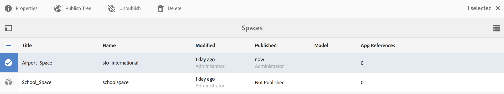

## スペース内のフォルダーの操作 {#working-with-folders-in-a-space}

スペースには、スペースのコンテンツとアセットをさらに整理するためのフォルダーを含めることができます。 ユーザーは、スペースの下に独自の階層を作成できます。

### フォルダーの作成 {#creating-a-folder}

1. スペース コンソールのリスト内のスペースをクリックし、**フォルダーを作成**&#x200B;をクリックします

   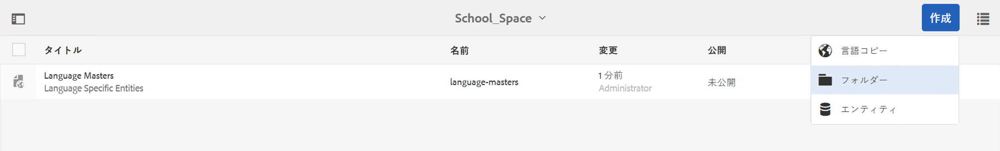

1. フォルダーの&#x200B;**タイトル**、**名前、**&#x200B;および&#x200B;**説明**&#x200B;を入力します

   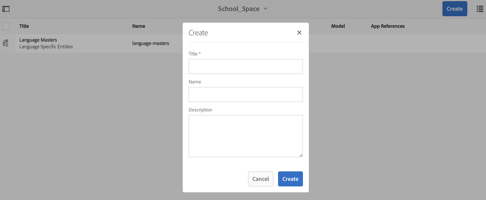

1. スペースにフォルダーを作成するには、**作成**&#x200B;をクリックします

## 言語コピー {#language-copy}

>[!CAUTION]
>
>言語コピーは、このリリースでは完全に機能しません。 構造を構築するだけです。

**言語コピー**&#x200B;機能を使用すると、作成者はマスター言語コピーをコピーし、プロジェクトとワークフローを作成してコンテンツを自動的に翻訳できます。 言語コピーは正しい構造を作成します。 スペースにフォルダーを追加したら、言語コピーをスペースに追加できます。

>[!NOTE]
>
>翻訳される可能性のあるコンテンツは、言語コピーノードの下に配置することをお勧めします。

### 言語コピーの追加 {#adding-language-copy}

1. スペースを作成したら、そのスペースをクリックして言語コピーを作成します。

   **作成**&#x200B;をクリックし、**言語コピー**&#x200B;を選択します。

   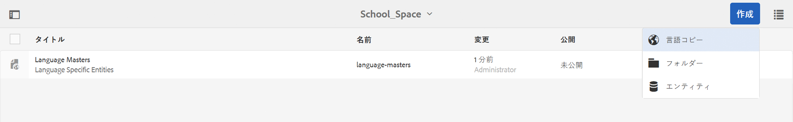

   >[!NOTE]
   >
   >言語コピーノードは、スペースの直接の子としてのみ存在できます。

1. **コンテンツパッケージ Language&ast;**&#x200B;を選択し、**言語コピーの作成** ダイアログに&#x200B;**Title&ast;**&#x200B;を入力します。

   「**作成**」をクリックします。

   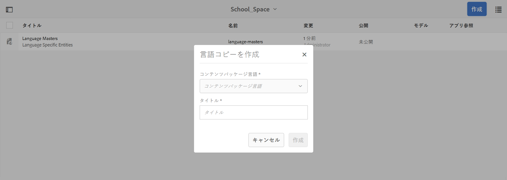

1. 言語コピーを作成すると、**言語マスター**&#x200B;のスペースに表示されます。

   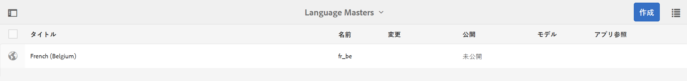

   >[!NOTE]
   >
   >**言語マスター**&#x200B;を選択して、言語コピーフォルダーを表示します。

### スペースからのフォルダーの削除 {#removing-a-folder-from-the-space}

1. スペースの内容のリストからフォルダーを選択します
1. ツールバーから&#x200B;**削除**&#x200B;をクリックします

   >[!NOTE]
   >
   >フォルダーに移動して、その内容を表示したり、サブフォルダーやエンティティを追加したりするには、スペースのコンテンツリストでフォルダーのタイトルをクリックします。

## スペース内のエンティティの操作 {#working-with-entities-in-a-space}

エンティティは、web サービスエンドポイントを通じて公開されるコンテンツを表します。 エンティティはスペースに保存されるので、を簡単に見つけることができ、関連するコンテンツを保持するAEM リポジトリ構造とは独立して保持されます。

ある論理的な集まりにエンティティをグループ化する場合に使用します。 これを行うには、任意の数のフォルダを作成できます。

他のエンティティであるエンティティの子がデータモデリングのために収集される場合、開発者ユーザーは、標準で提供される「エンティティ・グループ」モデル・タイプから特定の「グループ・モデル」を作成できます。

>[!NOTE]
>
>エンティティは常にスペースに関連付けられるため、エンティティのユーザーインターフェイスのほとんどはスペースコンソールからアクセスできます。

### エンティティの作成 {#creating-an-entity}

1. スペースコンソールを開き、スペースのタイトルをクリックします。

   必要に応じて、リスト内のフォルダーのタイトルをクリックして、フォルダーに移動できます。

   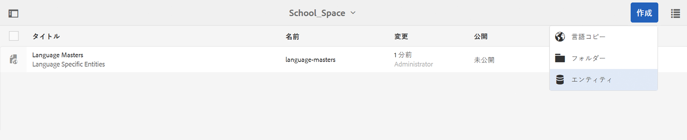

1. エンティティのモデルを選択します。 作成するエンティティのタイプです。 次へをクリックします。

   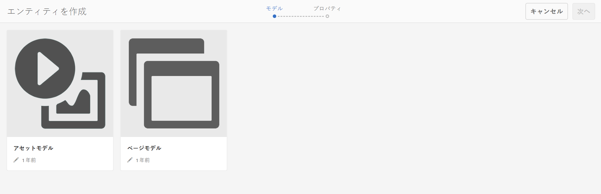

   >[!NOTE]
   >
   >**Assets モデル**、**ページモデル**、または以前に作成したエンティティタイプのモデルを選択できます。
   >
   >カスタムエンティティを作成するには、[&#x200B; モデルの作成](/help/mobile/administer-mobile-apps.md)を参照してください。

1. エンティティに&#x200B;**タイトル**、**名前**、**説明**&#x200B;および&#x200B;**タグ**&#x200B;を入力します。 「**作成**」をクリックします。

   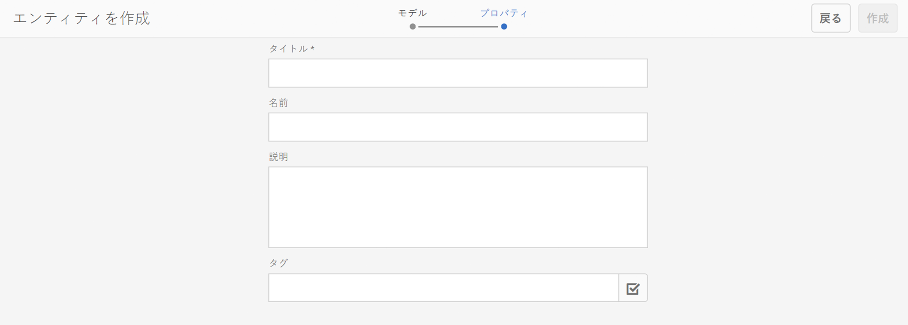

   完了すると、スペースの子孫にエンティティが表示されます。

### エンティティの編集 {#editing-an-entity}

1. エンティティを作成したら、フォルダーまたはスペースに移動し、スペースコンソールからエンティティを選択して編集します。

   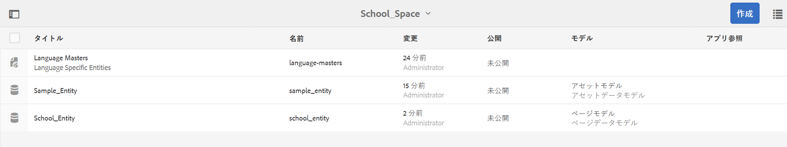

1. 編集するエンティティを選択し、**編集**&#x200B;をクリックします。

   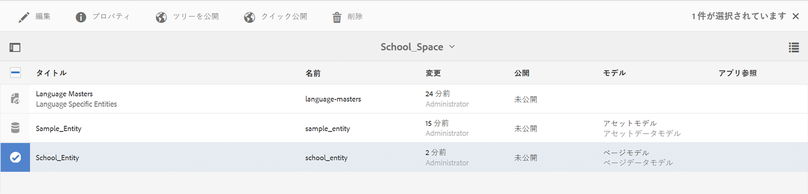

   >[!CAUTION]
   >
   >エンティティを作成するテンプレートに応じて、エンティティのプロパティを編集および表示するためのUIが異なります。 詳しくは、以下の手順を参照してください。

   ***Assets Models***&#x200B;としてエンティティを作成するためのテンプレートを選択した場合、**Edit**&#x200B;をクリックすると、次の図に示すようにアセットを追加できます。

   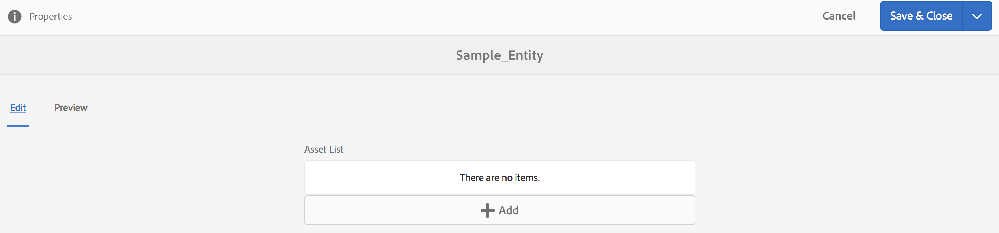

   または、**プレビュー**&#x200B;をクリックして、json リンクを表示することもできます。

   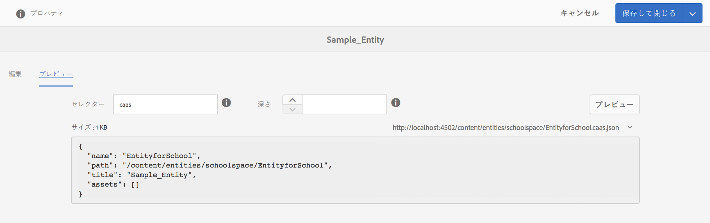

   ***ページモデル***&#x200B;としてエンティティを作成するためのテンプレートを選択した場合、**編集**&#x200B;をクリックすると、次の図に示すようにアセットを追加できます。

   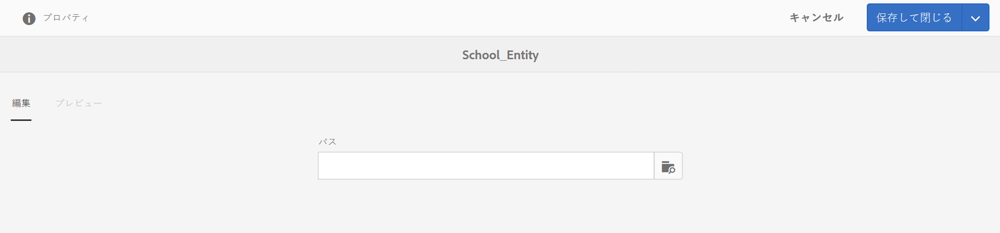

   **パス**&#x200B;のアイコンをクリックして、アセットを追加します

   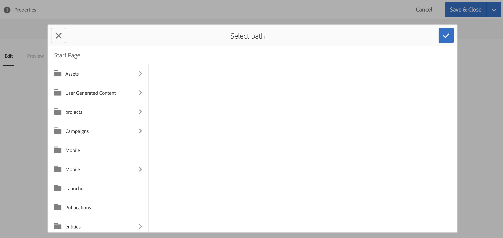

   >[!NOTE]
   >
   >エンティティを追加したら、「プレビュー」リンクが機能するように保存する必要があります。 プレビューを表示するには、**保存**&#x200B;をクリックします。 **プレビュー**&#x200B;をクリックすると、追加されたアセットのjsonが次の図に示されます。

   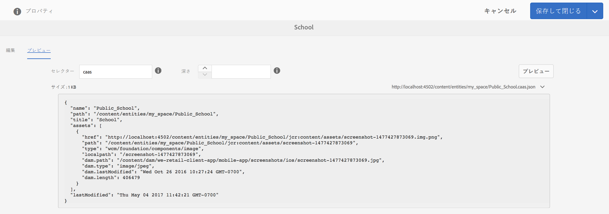

   >[!NOTE]
   >
   >エンティティへのアセットの追加が完了したら、**保存**&#x200B;を選択して変更を保存するか、**保存して閉じる**&#x200B;を選択して、エンティティが定義されているスペースコンソールリストに保存してリダイレクトできます。

   さらに、スペースコンソールリストからエンティティを選択し、**プロパティ**&#x200B;をクリックして、定義されたエンティティのプロパティを表示および編集します。

   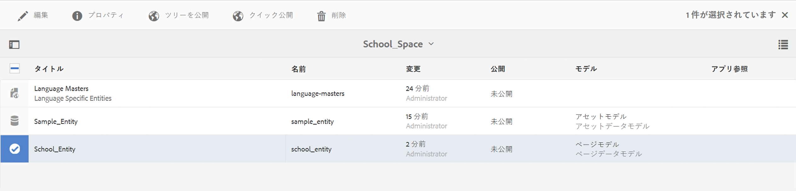

   タイトル、説明、タグを編集し、アセットをエンティティに追加できます。

   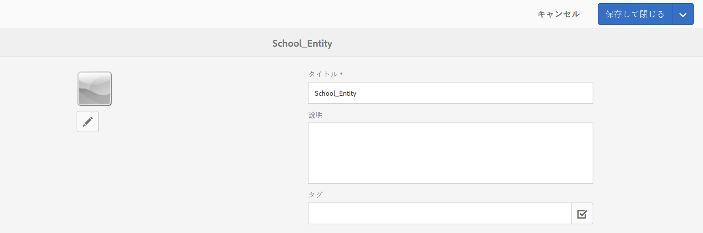

### エンティティの削除 {#removing-an-entity}

1. スペースの内容のリストからエンティティを選択します

   

1. ツールバーの&#x200B;**削除**&#x200B;をクリックして、特定のエンティティをスペースから削除します

### エンティティの公開 {#publishing-an-entity}

「**ツリーを公開**」または「**クイック公開**」を選択して、エンティティを公開するオプションがあります。

1. スペース コンソール リストからエンティティを選択し、**Publish Tree &#x200B;** をクリックして、そのエンティティとその子を公開します。

   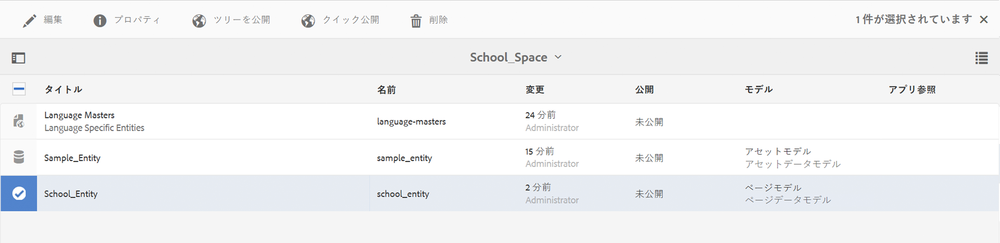

   **または**

   **クイック公開**&#x200B;をクリックして、特定のエンティティを公開します。
