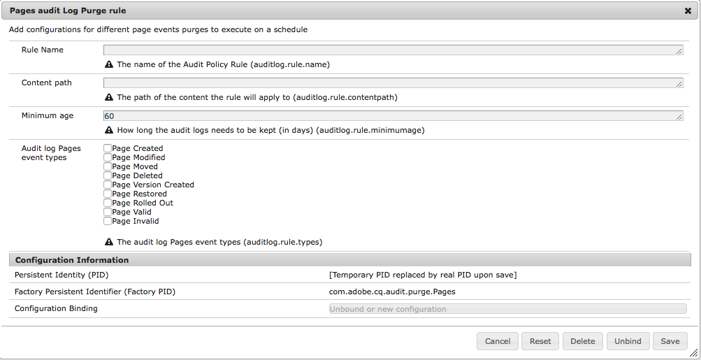
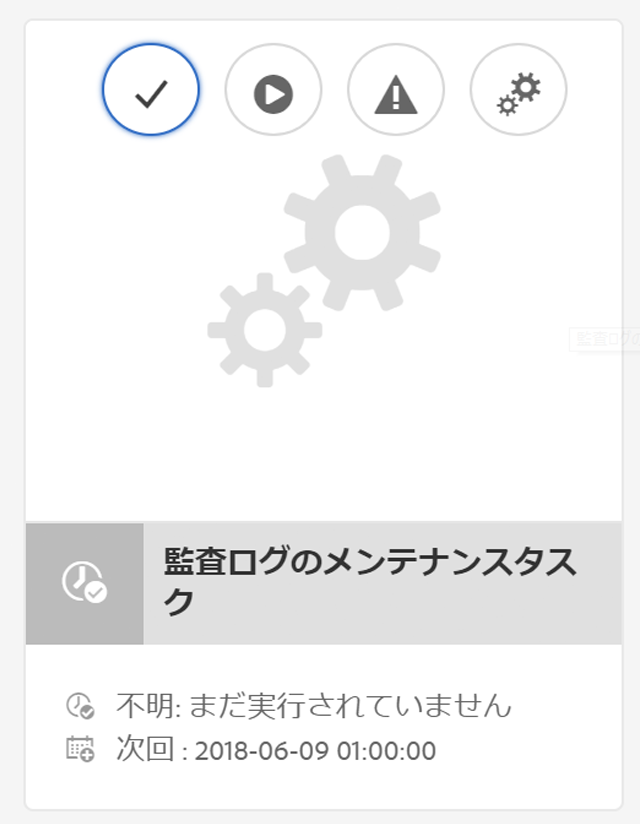

# AEM 6 での監査ログのメンテナンス{#audit-log-maintenance-in-aem}

監査ログの対象となる AEM イベントが発生すると、多くのアーカイブデータが生成されます。 このデータは、レプリケーション、アセットのアップロード、その他のシステムアクティビティによって、短期間で増大する可能性があります。

監査ログのメンテナンスに用意されているいくつかの機能要素を使用すると、特定のポリシー条件に基づいて監査ログのメンテナンスを自動化できます。

設定可能な週別メンテナンスタスクとして実装し、操作ダッシュボードモニタリングコンソールからアクセスできます。

詳しくは、[操作ダッシュボードのドキュメント](/help/sites-administering/operations-dashboard.md)を参照してください。

監査ログのパージオプションには 3 つのタイプがあります。

1. [ページ監査ログのパージの設定](/help/sites-administering/operations-audit-log.md#configure-page-audit-log-purging)
1. [DAM 監査ログのパージの設定](/help/sites-administering/operations-audit-log.md#configure-dam-audit-log-purging)
1. [レプリケーション監査ログのパージの設定](/help/sites-administering/operations-audit-log.md#configure-replication-audit-log-purging)

それぞれ AEM の web コンソールでルールを作成して設定できます。 設定後、**ツール／操作／メンテナンス／週別メンテナンスウィンドウ**&#x200B;に移動して、**監査ログのメンテナンスタスク**&#x200B;でそれらを実行することができます。

## ページ監査ログのパージの設定 {#configure-page-audit-log-purging}

監査ログのパージを設定するには、次の手順に従います。

1. ブラウザーに `http://localhost:4502/system/console/configMgr/` と入力して、web コンソール管理に移動します。

1. 「**ページ監査ログパージルール**」という項目を検索してクリックします。

   

1. 次に、要件に従ってパージスケジューラーを設定します。 使用できるオプションは以下のとおりです。

   * **ルール名：**&#x200B;監査ポリシールールの名前。
   * **Content path：**&#x200B;ルールが適用されるコンテンツのパス。
   * **最小経過期間：**&#x200B;監査ログを保持しておく必要がある日数。
   * **監査ログタイプ：**&#x200B;パージする必要がある監査ログのタイプ。

   >[!NOTE]
   >
   >コンテンツパスは、リポジトリの `/var/audit/com.day.cq.wcm.core.page` ノードの子にのみ適用されます。

1. ルールを保存します。
1. 作成したルールを実行するためには、操作ダッシュボードに公開する必要があります。 そのためには、AEM のようこそ画面から&#x200B;**ツール／操作／メンテナンス**&#x200B;に移動します。

1. **週別メンテナンスウィンドウ**&#x200B;カードをクリックします。

1. メンテナンスタスクは、**AuditLog メンテナンスタスク**&#x200B;カードの下に既に存在しています。

   

1. 次回実行の日付を調べて設定するか、再生ボタンをクリックして手動で実行できます。

AEM 6.3 では、監査ログのパージタスクが完了する前に、スケジュールされたメンテナンスウィンドウを閉じると、タスクは自動的に停止します。 次回のメンテナンスウィンドウを開くと、タスクは再開されます。

**AEM 6.5** で実行中の監査ログのパージタスクを手動で停止するには、「**停止**」アイコンをクリックします。 次回の実行時に、タスクは安全に再開されます。

>[!NOTE]
>
>メンテナンスタスクを停止すると、既に処理中のジョブのトラックを維持しながら、実行を一時停止できます。

## DAM 監査ログのパージの設定 {#configure-dam-audit-log-purging}

1. *https://&lt;serveraddress>:&lt;serverport>/system/console/configMgr* にあるシステムコンソールに移動します。
1. **DAM 監査ログのパージ**&#x200B;ルールを探して結果をクリックします。
1. それに従って、次のウィンドウでルールを設定します。 オプションは以下のとおりです。

   * **ルール名：**&#x200B;監査ポリシールールの名前。
   * **Content path：**&#x200B;ルールが適用されるコンテンツのパス。
   * **最小経過期間：**&#x200B;監査ログを保持しておく必要がある日数
   * **監査ログ DAM イベントタイプ：**&#x200B;パージする必要がある DAM 監査イベントのタイプ。

1. 「**保存**」をクリックして設定を保存します。

## レプリケーション監査ログのパージの設定  {#configure-replication-audit-log-purging}

1. *https://&lt;serveraddress>:&lt;serverport>/system/console/configMgr* にあるシステムコンソールに移動します。
1. **レプリケーション監査ログのパージスケジューラー**&#x200B;を探して結果をクリックします
1. それに従って、次のウィンドウでルールを設定します。 オプションは以下のとおりです。

   * **ルール名：**&#x200B;監査ポリシールールの名前
   * **Content path：**&#x200B;ルールが適用されるコンテンツのパス。
   * **最小経過期間：**&#x200B;監査ログを保持しておく必要がある日数
   * **監査ログレプリケーションイベントタイプ：**&#x200B;パージする必要があるレプリケーション監査イベントのタイプ

1. 「**保存**」をクリックして設定を保存します。
