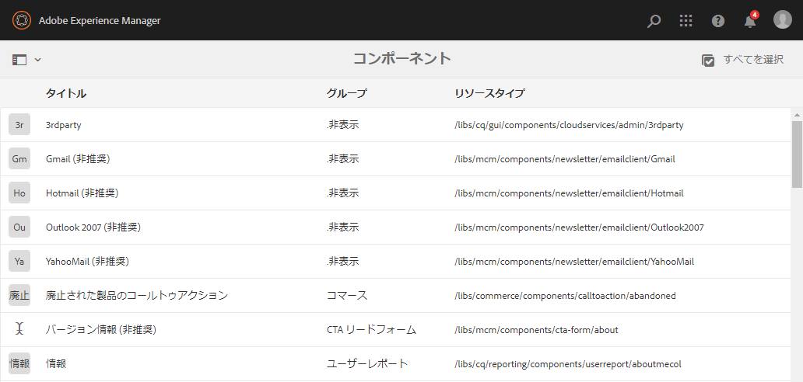
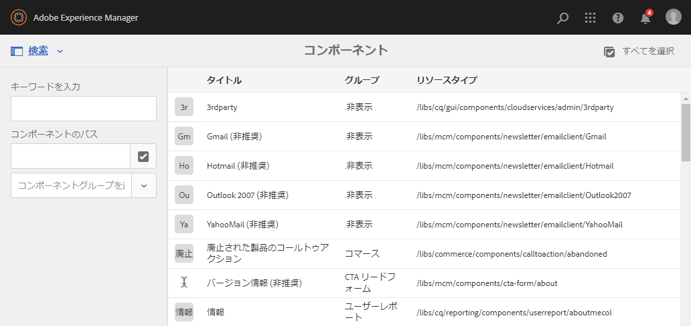
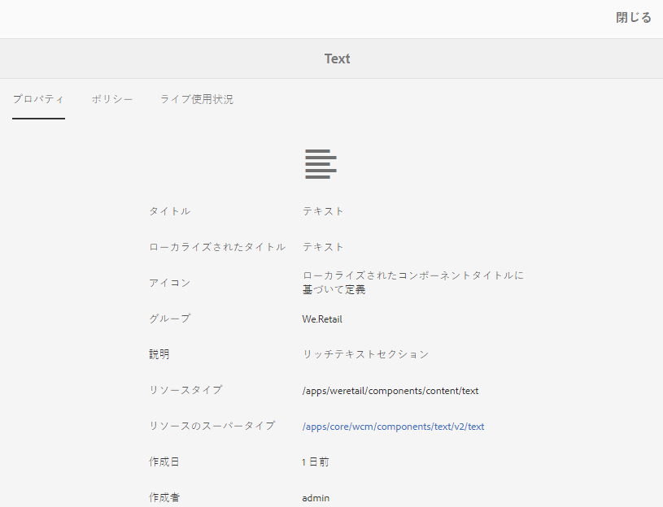
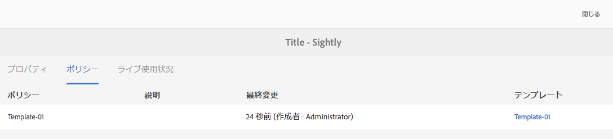
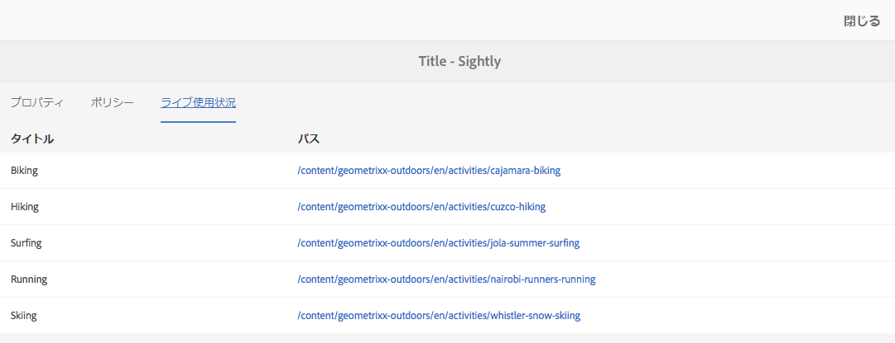
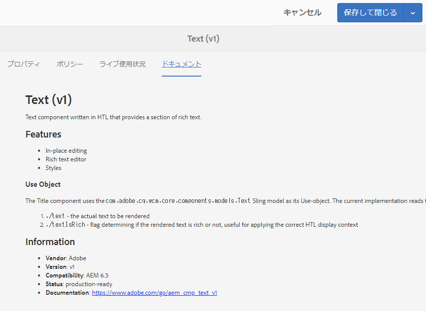

# コンポーネントコンソール{#components-console}

コンポーネントコンソールを使用すると、インスタンスに定義されたすべてのコンポーネントを参照し、各コンポーネントの主な情報を確認できます。

**ツール**／**一般**／**コンポーネント**&#x200B;からアクセスできます。 コンソールでは、カード表示およびリスト表示を使用できます。 コンポーネントのツリー構造がないので、列表示は使用できません。

>[!NOTE]
>
>コンポーネントコンソールには、システムのすべてのコンポーネントが表示されます。 [コンポーネントブラウザー](/help/sites-authoring/author-environment-tools.md#components-browser)には、作成者が使用できるコンポーネントが表示され、ピリオド（`.`）で始まるすべてのコンポーネントグループは非表示になります。

## 検索 {#searching}

「**コンテンツのみ**」アイコン（左上）を使用して「**検索**」パネルを開き、コンポーネントの検索やフィルタリングを行うことができます。

### コンポーネントの詳細 {#component-details}

特定のコンポーネントに関する詳細を表示するには、必要なリソースをクリックします。 次の 3 つのタブが表示されます。

* **プロパティ**

  

  「プロパティ」タブでは、次のことができます。

  * コンポーネントの一般的なプロパティの表示。
  * コンポーネントの[アイコンまたは省略形の定義](/help/sites-developing/components-basics.md#component-icon-in-touch-ui)方法の表示。

    * アイコンのソースをクリックすると、そのコンポーネントが表示されます。

  * コンポーネントの&#x200B;**リソースタイプ**&#x200B;および&#x200B;**リソースのスーパータイプ**（定義されている場合）が表示されます。

    * リソースのスーパータイプをクリックすると、そのコンポーネントが表示されます。

  >[!NOTE]
  >
  >`/apps` は実行時には編集できないので、コンポーネントコンソールは読み取り専用です。

* **ポリシー**

  

* **ライブ使用状況**

  

  >[!CAUTION]
  >
  >この表示で収集される情報の性質から、照合および表示には時間がかかることがあります。

* **ドキュメント**

  デベロッパーが[コンポーネント用ドキュメント](/help/sites-developing/developing-components.md#documenting-your-component)を提供している場合、「**ドキュメント**」タブに表示されます。 利用できるドキュメントがない場合は、「**ドキュメント**」タブは表示されません。

  
