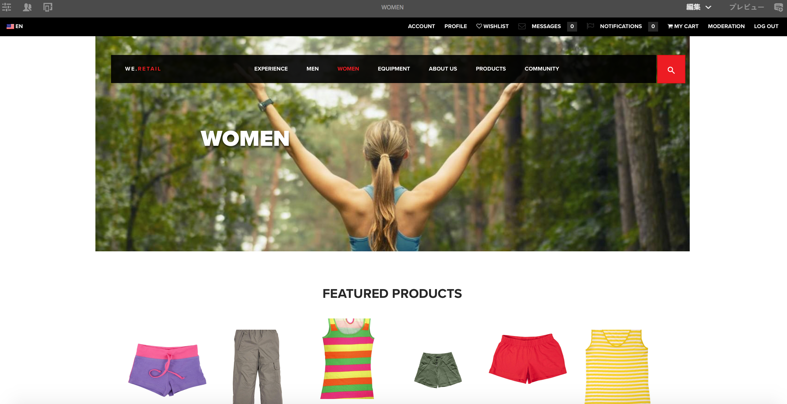

# モバイルデバイス用のページのオーサリング{#authoring-a-page-for-mobile-devices}

モバイルページをオーサリングする場合、ページはモバイルデバイスをエミュレートする方法で表示されます。 ページのオーサリング時に、いくつかのエミュレーターを切り替えて、エンドユーザーがページにアクセスしたときの表示を確認できます。

デバイスは、ページをレンダリングするデバイスの機能に応じて、フィーチャー、スマート、およびタッチのカテゴリにグループ分けされます。 エンドユーザーがモバイルページにアクセスするときは、AEM はデバイスを検出して、そのデバイスグループに対応する表示域を送信します。

>[!NOTE]
>
>既存の標準サイトに基づいたモバイルサイトを作成するには、標準サイトのライブコピーを作成します。 （[様々なチャネル用のライブコピーを作成する](/help/sites-administering/msm-livecopy.md)を参照）。
>
>AEM 開発者は、新しいデバイスグループを作成できます （「[デバイスグループフィルターの作成](/help/sites-developing/groupfilters.md)」を参照）。

次の手順を使用して、モバイルページをオーサリングします。

1. グローバルナビゲーションから&#x200B;**サイト**&#x200B;コンソールを開きます。
1. **We.Retail**／**アメリカ合衆国**／**英語**&#x200B;のページを開きます。

1. **プレビュー**&#x200B;モードに切り替えます。
1. ページ上部のデバイスアイコンをクリックして、目的のエミュレーターに切り替えます。
1. コンポーネントをコンポーネントブラウザーからドラッグしてページにドロップします。

ページは次のようになります。

>[!NOTE]
>
>モバイルデバイスからオーサーインスタンスのページが要求されると、エミュレーターは無効になります。
