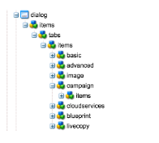
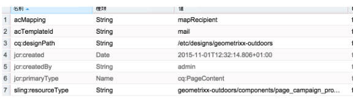

# Adobe Campaign フォームコンポーネントを使用したカスタム AEM ページテンプレートの作成{#creating-custom-aem-page-template-with-adobe-campaign-form-components}

このページでは、Geometrixx-outdoors テンプレート（`/apps/geometrixx-outdoors/components/page_campaign_profile`）の実装方法を確認することによって、[Adobe Campaign フォーム](/help/sites-authoring/adobe-campaign-components.md)コンポーネントを使用するカスタムページテンプレートの作成方法を説明し、独自のカスタムテンプレート作成時に必要になる可能性がある重要な情報を示します。

>[!CAUTION]
>
>AEM メールコンポーネントは非推奨となりました。 コンテンツとスタイルを結合するメールの性質上、AEM で標準で提供されるメールコンポーネントは、プロジェクトで必要なすべてのコンポーネントにカスタムスタイルを実装する必要があるので、顧客による再利用の機会は限られています。
>
>メールコンポーネントはプロジェクトレベルで実装できます。その方法は、非推奨の AEM メールコンポーネントを見ればわかります。 ただし、これらの非推奨コンポーネントはプロジェクトで使用しないでください。


Adobe Campaign フォームコンポーネントを使用してカスタム AEM ページテンプレートを作成するには、以下を確認してください。

1. **適切な resourceSuperType**

   ページコンポーネントを `mcm/campaign/components/profile` から継承していることを確認してください。

   これは、サーブレットが情報を取得および保存するために必要です。

   * `com.day.cq.mcm.campaign.servlets.TemplateListServlet`
   * `com.day.cq.mcm.campaign.servlets.SaveProfileServlet`

   

1. **ClientContext 設定**

   ClientContext 設定（`/etc/designs/geometrixx-outdoors/jcr:content/page_campaign_profile`）には、次の設定があります。

   * ClientContext が `/etc/clientcontext/campaign` を指している
   * 追加の *config* ノードもあります。

   

1. **head.jsp（/apps/geometrixx-outdoors/components/page_campaign_profile/head.jsp）**

   **head.jsp** には、**clientcontext-config** と **cloudservice-hook** を使用する以下の行があります。

   ```
   <cq:include path="config" resourceType="cq/personalization/components/clientcontext_optimized/config"/>
   <sling:include path="contexthub" resourceType="granite/contexthub/components/contexthub"/>
   <cq:include script="/libs/cq/cloudserviceconfigs/components/servicelibs/servicelibs.jsp"/>
   ```

1. **body.jsp（/apps/geometrixx-outdoors/components/page_campaign_profile/body.jsp）**

   **body.jsp** では、クラウドサービスがページ下部に読み込まれます。

   ```
   <cq:include path="cloudservices" resourceType="cq/cloudserviceconfigs/components/servicecomponents"/>
   ```

1. **Campaign のページプロパティ**

   Adobe Campaign テンプレートを選択できるようにするには、「**Campaign**」タブを使用して、ページプロパティを拡張します。

   `/apps/geometrixx-outdoors/components/page_campaign_profile/dialog/items/tabs/items/campaign`

   

1. **テンプレートの設定**

   テンプレート（`/apps/geometrixx-outdoors/templates/campaign_profile/jcr:content`）には、次のデフォルト値があります。

   | **acMapping** | mapRecipient（Adobe Campaign 6.1 の場合）、profile（Adobe Campaign Standard の場合） |
   |---|---|
   | **acTemplateId** | mail |

   
