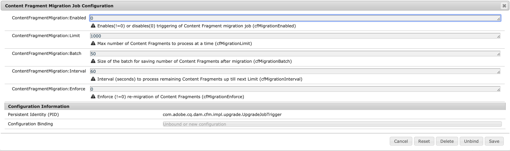

# 最適化された GraphQL フィルタリング用コンテンツフラグメントの更新 {#updating-content-fragments-for-optimized-graphql-filtering}

GraphQL フィルターのパフォーマンスを最適化するには、コンテンツフラグメントを更新する手順を実行する必要があります。

>[!NOTE]
>
>コンテンツフラグメントを更新した後、[GraphQL クエリの最適化](/help/sites-developing/headless/graphql-api/graphql-optimization.md)についての推奨事項に従うことができます。

## 前提条件 {#prerequisites}

AEMの6.5.17.0 リリース以上が必要です。

## コンテンツフラグメントの更新 {#updating-content-fragments}

この手続きを実行するには、次の手順に従います。

1. **コンテンツフラグメント移行ジョブ設定** の [OSGi 設定を指定します](/help/sites-deploying/configuring-osgi.md)。

   

1. ダイアログで、これら 2 つのパラメーターを次のように設定します。

   * **ContentFragmentMigration:Enabled** : `1`
   * **ContentFragmentMigration:Enforce** : `1`

1. 指定した値を&#x200B;**保存**&#x200B;します。更新手続きが開始されます。

1. 手続きが完了するまで待ちます。 プロパティ `cfGlobalVersion` が `/content/dam` に表示され `1` に設定されたら、手続きは完了です。

1. OSGi 設定に戻って、手続きのアクティベートを解除します。

   **コンテンツフラグメント移行ジョブ設定**&#x200B;のダイアログで、これら 2 つのパラメータを次のように設定します。

   * **ContentFragmentMigration:Enabled** : `0`
   * **ContentFragmentMigration:Enforce** : `0`

## 制限事項 {#limitations}

次の制限事項に注意してください。

* GraphQL フィルターのパフォーマンスの最適化は、すべてのコンテンツフラグメントを完全に更新した後にのみ可能です（JCR ノード `/content/dam` の `cfGlobalVersion` のプロパティが存在することで示される）

* コンテンツフラグメントをコンテンツパッケージから読み込む場合（`crx/de` を使用）、更新手順を実行してから、更新手順が再実行されるまで、これらのコンテンツフラグメントは GraphQL クエリ結果で考慮されません。
