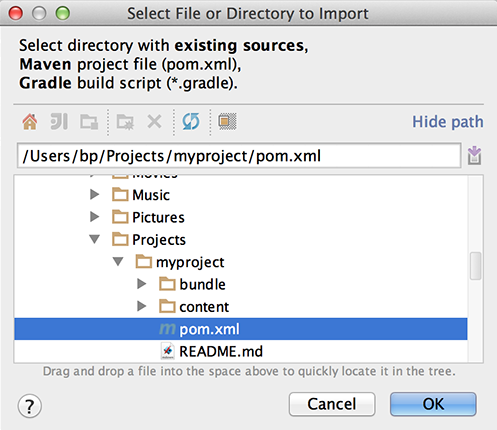
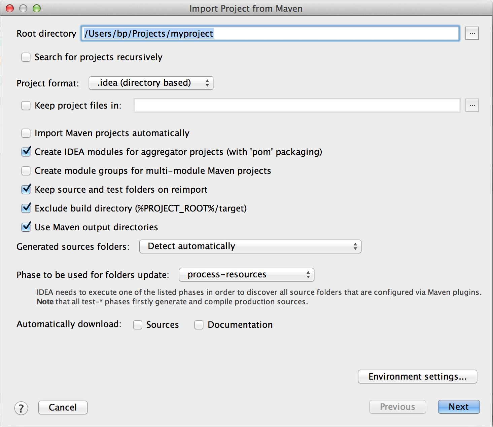
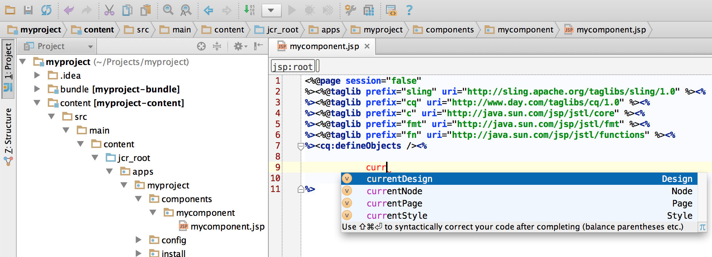
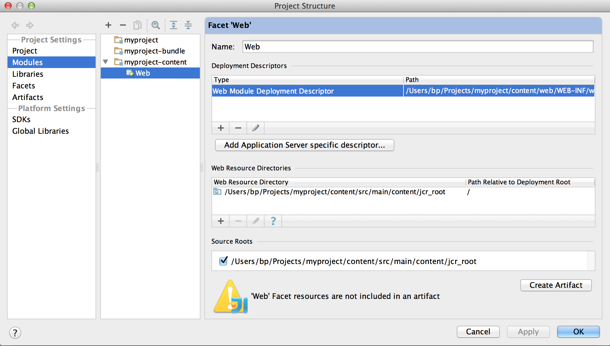
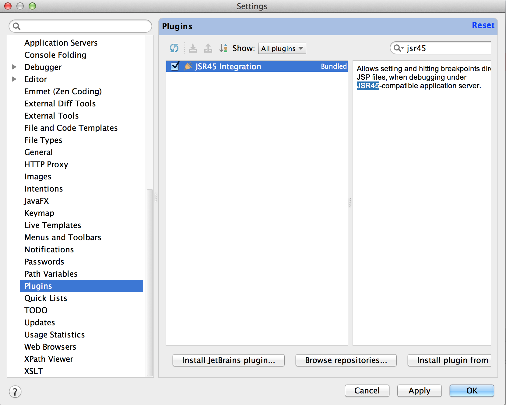
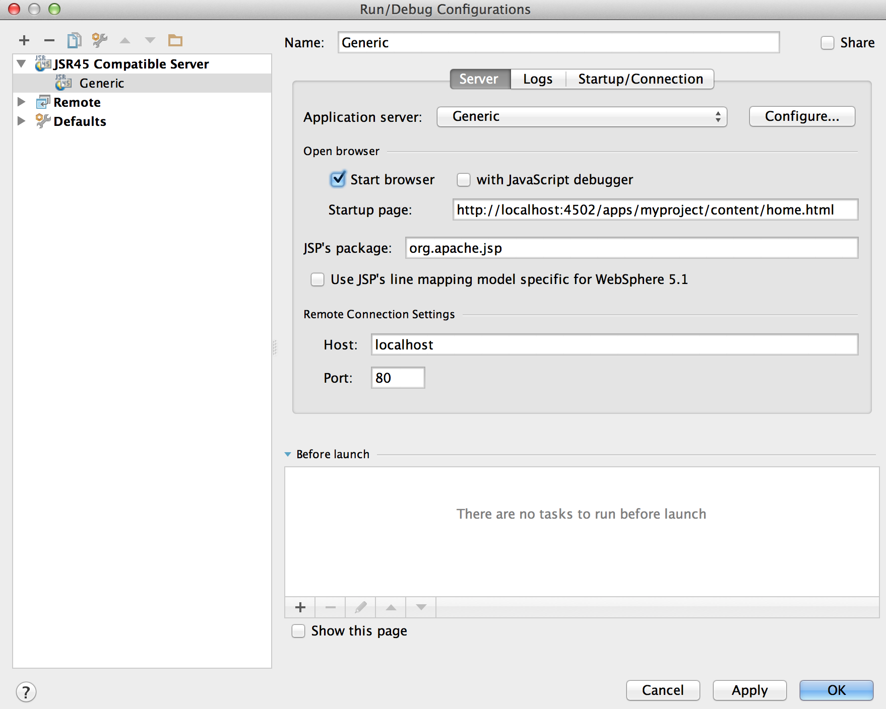
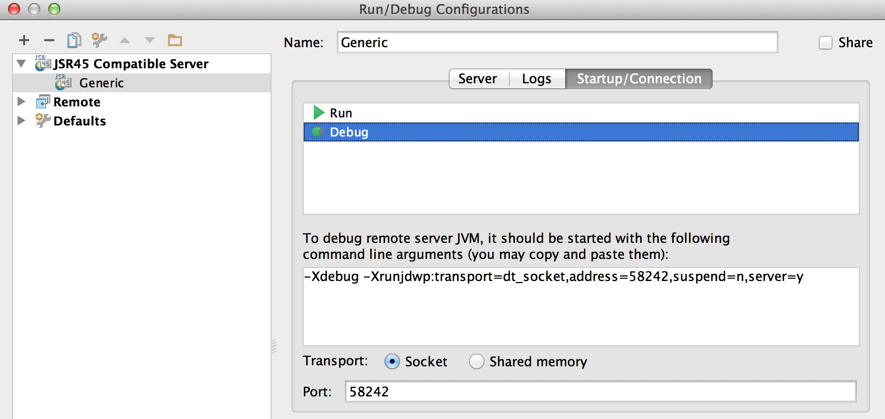
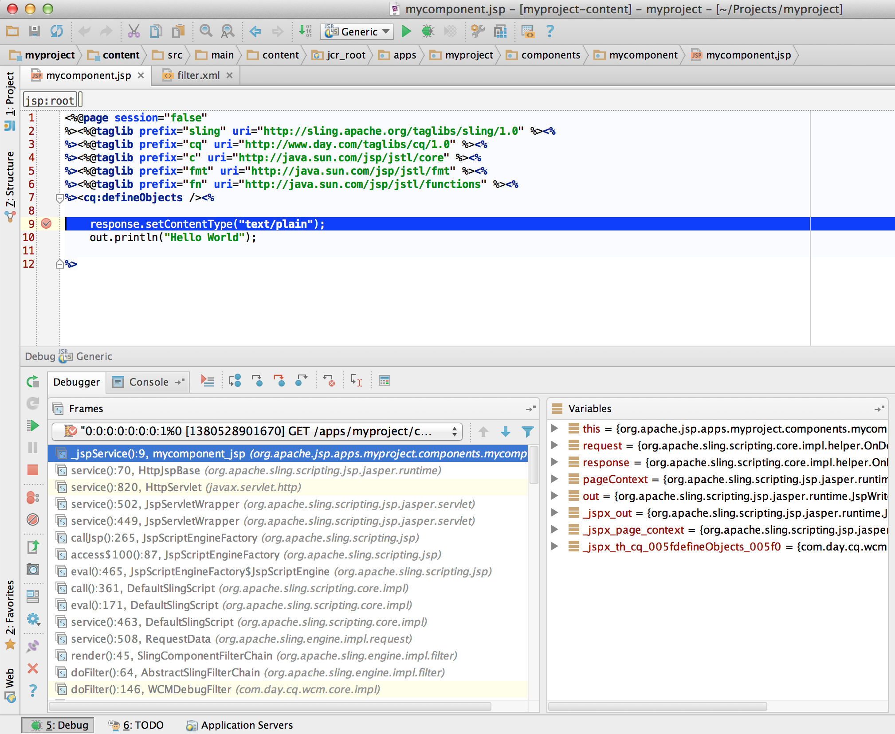

# IntelliJ IDEA を使用して AEM プロジェクトを開発する方法{#how-to-develop-aem-projects-using-intellij-idea}

## 概要 {#overview}

IntelliJ で AEM の開発を開始するには、次の手順を実行する必要があります。

各手順の詳細については、このトピックで後述します。

* IntelliJ のインストール
* Maven に基づく AEM プロジェクトの設定
* Maven POM での IntelliJ 用の JSP サポートの準備
* IntelliJ への Maven プロジェクトの読み込み

>[!NOTE]
>
>このガイドは IntelliJ IDEA Ultimate Edition 12.1.4 と AEM 5.6.1 を基に作成されています。

### IntelliJ IDEA のインストール {#install-intellij-idea}

[JetBrains のダウンロードページ](https://www.jetbrains.com/idea/download/)から IntelliJ IDEA をダウンロードします。

そのページのインストール手順に従ってください。

### Maven に基づく AEM プロジェクトの設定 {#set-up-your-aem-project-based-on-maven}

次に、[Apache Maven を使用して AEM プロジェクトをビルドする方法](/help/sites-developing/ht-projects-maven.md)に記載されている手順に従って、Maven を使用してプロジェクトを設定します。

IntelliJ IDEA で AEM プロジェクトを使用するには、[5 分で完了する作業準備](https://maven.apache.org/guides/getting-started/maven-in-five-minutes.html)で説明する基本設定を行ってください。

### IntelliJ IDEA 用の JSP サポートの準備 {#prepare-jsp-support-for-intellij-idea}

IntelliJ IDEA では JSP との連携もサポートされます。サポートされる項目の例を次に示します。

* タグライブラリのオートコンプリート
* `<cq:defineObjects />` と `<sling:defineObjects />` で定義されたオブジェクトの認知

サポートを有効にするには、[Apache Maven を使用して AEM プロジェクトをビルドする方法](/help/sites-developing/ht-projects-maven.md)の [JSP を使用する方法](/help/sites-developing/ht-projects-maven.md#how-to-work-with-jsps)に記載されている手順に従います。

### Maven プロジェクトの読み込み {#import-the-maven-project}

1. 次の手順を使用して、IntelliJ IDEA で&#x200B;**読み込み**&#x200B;ダイアログを開きます。

   * プロジェクトを開いていない場合は、ようこそ画面の「**プロジェクトを読み込む**」を選択します。
   * メインメニューから&#x200B;**ファイル／プロジェクトを読み込む**&#x200B;を選択します。

1. 読み込みダイアログで、プロジェクトの POM ファイルを選択します。

   

1. 次のダイアログに示すデフォルト設定を使用して続行します。

   

1. 以降のダイアログで繰り返し「**次へ**」をクリックし、最後に「**終了**」をクリックします。
1. これで、IntelliJ IDEA を使用した AEM 開発用の設定は完了です。

   

### IntelliJ IDEA による JSP のデバッグ {#debugging-jsps-with-intellij-idea}

IntelliJ IDEA を使用して JSP をデバッグするには、次の手順を行う必要があります。

* プロジェクトでの web ファセットの設定
* JSR45 サポートプラグインのインストール
* デバッグプロファイルの設定
* デバッグモード用の AEM の設定

#### プロジェクトでの web ファセットの設定 {#set-up-a-web-facet-in-the-project}

デバッグ用の JSP を検索する場所を IntelliJ IDEA で認識する必要があります。 IDEA では `content-package-maven-plugin` 設定を解釈できないので、これを手動で設定する必要があります。

1. **ファイル／プロジェクト構造**&#x200B;に移動します。
1. 「**コンテンツ**」モジュールを選択します。
1. モジュールのリストの上にある「**+**」をクリックして、「**Web**」を選択します。
1. Web リソースディレクトリとして、以下のスクリーンショットに示すように、プロジェクトの `content/src/main/content/jcr_root subdirectory` を選択します。



#### JSR45 サポートプラグインのインストール {#install-the-jsr-support-plugin}

1. IntelliJ IDEA 設定の&#x200B;**プラグイン**&#x200B;ウィンドウに移動します。
1. 「**JSR45 Integration**」プラグインに移動して、その横にあるチェックボックスをオンにします。
1. 「**適用**」をクリックします。
1. 再起動するよう要求されたら、IntelliJ IDEA を再起動します。



#### デバッグプロファイルの設定 {#configure-a-debug-profile}

1. **実行／設定を編集**&#x200B;に移動します。
1. 「**+**」をクリックして「**JSR45 Remote**」を選択します。
1. 設定ダイアログで、「**アプリケーションサーバー**」の横にある「**設定**」を選択して、Generic サーバーを設定します。
1. デバッグの開始時にブラウザーを開く場合は、開始ページを適切な URL に設定します。
1. vlt autosync を使用する場合は、「**起動前**」タスクをすべて削除します。使用しない場合は、適切な Maven タスクを設定します。
1. **スタートアップ／接続**&#x200B;パネルで、必要に応じてポートを調整します。
1. IntelliJ IDEA が処理するコマンドライン引数をコピーします。

 

#### デバッグモード用の AEM の設定 {#configure-aem-for-debug-mode}

必要な最後の手順は、IntelliJ IDEA が推奨する JVM オプションを指定して AEM を起動することです。

AEM jar ファイルを直接起動して、これらのオプションを追加します。例えば、次のコマンドラインを使用します。

`java -Xdebug -Xrunjdwp:transport=dt_socket,address=58242,suspend=n,server=y -Xmx1024m -jar cq-quickstart-6.5.0.jar`

また、次に示すように、`crx-quickstart/bin/start` の起動スクリプトにこれらのオプションを追加することもできます。

```shell
# ...

# default JVM options
if [ -z "$CQ_JVM_OPTS" ]; then
 CQ_JVM_OPTS='-server -Xmx1024m -Djava.awt.headless=true'
fi

CQ_JVM_OPTS="$CQ_JVM_OPTS -Xdebug -Xrunjdwp:transport=dt_socket,address=58242,suspend=n,server=y"

# ...
```

#### デバッグの開始 {#start-debugging}

これで、AEM における JSP のデバッグ用の設定はすべて完了です。

1. **実行／デバッグ／デバッグプロファイル**&#x200B;を選択します。
1. コンポーネントのコードにブレークポイントを設定します。
1. ブラウザーでページにアクセスします。



### IntelliJ IDEA によるバンドルのデバッグ {#debugging-bundles-with-intellij-idea}

標準の汎用リモートデバッグ接続を使用して、バンドル内のコードをデバッグできます。 [リモートデバッグに関する Jetbrain のドキュメント](https://www.jetbrains.com/help/idea/remote-debugging-with-product.html#remote-interpreter)の手順に従ってください。
