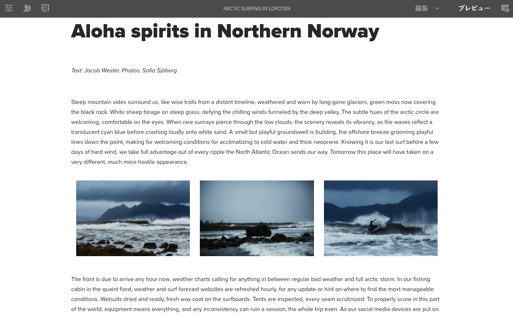
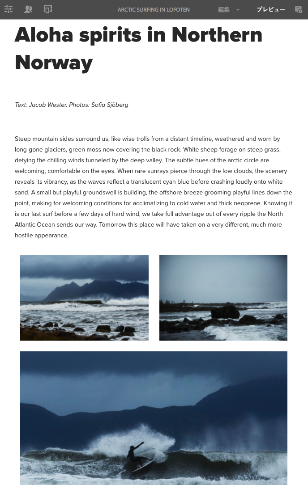
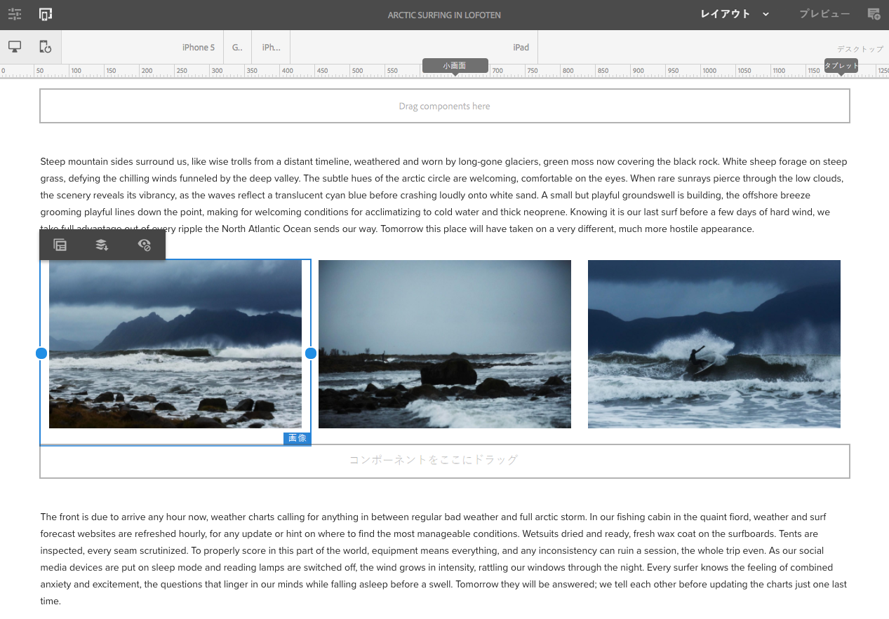
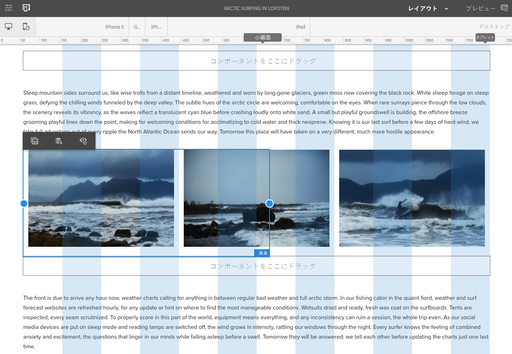

# We.Retail のレスポンシブレイアウトの使用{#trying-out-responsive-layout-in-we-retail}

We.Retail のすべてのページでは、レスポンシブデザインを実装するためにレイアウトコンテナコンポーネントが使用されています。 レイアウトコンテナは、レスポンシブグリッド内にコンポーネントを配置できる段落システムを提供します。 このグリッドでは、デバイスやウィンドウのサイズと形式に応じてレイアウトを並べ替えることができます。 このコンポーネントを、ページエディターの&#x200B;**レイアウト**&#x200B;モードと組み合わせて使用すると、デバイスに依存するレスポンシブレイアウトを作成および編集できます。

## 試してみる {#trying-it-out}

1. 言語メインブランチの「エクスペリエンス」セクションで、Arctic Surfing ページを編集します。

   http://localhost:4502/editor.html/content/we-retail/language-masters/en/experience/arctic-surfing-in-lofoten.html

1. **プレビュー**&#x200B;に切り替えて、web サイトの訪問者に対して表示されるページを確認します。 記事「*Aloha spirits in Norther Norway*」のコンテンツまでスクロールダウンします。

   

1. ブラウザーウィンドウのサイズを変更し、そのサイズ変更に対してレイアウトが動的に調整されることを確認します。

   

1. レイアウトモードに切り替えます。 エミュレーターツールバーが自動的に表示されます。このツールバーを使用して、ターゲットデバイスごとにレイアウトを計画できます。

   コンポーネントを選択すると、編集メニューにフローティングおよび非表示オプションと共に、コンポーネントのサイズ変更ハンドルが表示されます。

   

1. コンポーネントのサイズ変更ハンドルを選択してドラッグすると、サイズ変更に役立つレイアウトグリッドが自動的に表示されます。

   

## その他の情報 {#further-information}

詳しくは、オーサリングドキュメントの[レスポンシブレイアウト](/help/sites-authoring/responsive-layout.md)または管理者向けドキュメントの[レイアウトコンテナとレイアウトモードの設定](/help/sites-administering/configuring-responsive-layout.md)を参照してください。
